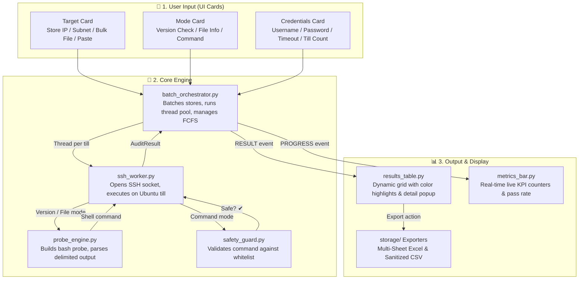

# 🏗️ File Inspector — Complete Architecture & Developer Guide

> 📊 **Interactive Archify Diagram:** [architecture-diagram.html](architecture-diagram.html)
> 
> **Last Updated:** 2026-09-24 | **Total Files:** 27 | **Language:** Python 3 + Tkinter | **Target:** Ubuntu POS Tills  
> 
> 💡 *This guide is designed for developers and operators. It explains every single file, function, data flow, and "ripple effect" in plain English. Whenever you need to modify code, look up that file's "If you change this... It affects..." table and the Developer Cookbook.*

---

## 📂 Project Structure at a Glance

```text
file_checker/
├── main.py                    ← 🚀 Primary Entry point (starts the GUI app)
├── gui.py                     ← 🪟 Launcher alias (points to main.py)
├── cli.py                     ← 💻 Headless CLI runner (for cron/CI batch audits)
├── config.json                ← 💾 Persistent user settings & default parameters
├── requirements.txt           ← 📦 pip dependencies (paramiko>=2.11.0 only)
├── build_exe.py / .bat        ← 🔨 Automation to build standalone FileChecker.exe
├── demo_stores.csv / .xlsx    ← 📋 Sample store datasets for testing
│
├── core/                      ← 🧠 BRAIN — All business logic & networking lives here
│   ├── ssh_worker.py          ← ⭐ The actual SSH executor (runs commands on tills)
│   ├── probe_engine.py        ← 🔍 Builds compound shell probes & parses outputs
│   ├── safety_guard.py        ← 🛡️ Strict command whitelist enforcer & pipe checker
│   ├── batch_orchestrator.py  ← 🎯 Manages worker threads, store batching, pause/stop
│   └── config_manager.py      ← ⚙️ Reads/writes config.json with thread-safe locks
│
├── models/                    ← 📦 DATA MODELS — Pure data structures (no UI logic)
│   ├── target.py              ← TillTarget & StoreRecord + IP resolution rules
│   └── result.py              ← AuditResult & AuditStatus definitions + KPI counters
│
├── storage/                   ← 💽 STORAGE — Import/export file engines
│   ├── store_reader.py        ← 📥 Reads CSV/Excel store lists & re-audit failure lists
│   ├── csv_exporter.py        ← 📤 Exports results to CSV (formula injection safe)
│   └── excel_exporter.py      ← 📤 Generates multi-sheet Excel workbooks (zero openpyxl)
│
└── ui/                        ← 🎨 USER INTERFACE — Everything you SEE on screen
    ├── app.py                 ← 🪟 Main window orchestrator & thread-safe event queue
    ├── theme.py               ← 🎨 Colors, fonts, tag styling, dark tokens
    └── components/            ← Modular UI panels & cards
        ├── target_card.py      ← "1. Store IP / Targets" card (Single/Bulk/Paste)
        ├── credentials_card.py ← "2. SSH Settings" card (User, Pass, Timeout, Count)
        ├── mode_card.py        ← "3. Operations" card (Version Check / File / Command)
        ├── metrics_bar.py      ← Live KPI cards (Progress, Success, Mismatches...)
        ├── filter_toolbar.py   ← Quick filter buttons (All, Success, Errors...) + Search
        └── results_table.py    ← Dynamic results grid + double-click detail popup modal
```

---

## 🔄 How Data Flows (The Big Picture)



---

## 📄 File-by-File Deep Dive

---

### 🚀 `main.py` & `gui.py` — Application Entry Points

**What it does:** Starts the desktop application. Sets up high-DPI scaling on Windows and boots the Tkinter mainloop. That's it!

```python
# main.py
from ui.app import FileCheckerApp

if __name__ == "__main__":
    app = FileCheckerApp()
    app.mainloop()
```

| If you change this... | It affects... |
|---|---|
| Import path of `FileCheckerApp` | App will fail to start |
| `gui.py` | Nothing else (`gui.py` is just an alias importing `main.py`) |

- **Who calls this:** The user (double-clicking the desktop icon or running `python main.py`).

---

### 💻 `cli.py` — Headless CLI Runner

**What it does:** Runs audits from the command line without opening any graphical window. Perfect for scheduled cron jobs, Jenkins pipelines, or automated night-audits.

| Function | What it does |
|---|---|
| `main()` | Parses command-line flags (`--stores`, `--mode`, `--user`, `--password`, `--out`), runs the orchestrator, and saves the Excel report |

```bash
# Example CLI run:
python cli.py --stores demo_stores.csv --mode version_war --user posadmin --password mypassword --out audit_results.xlsx
```

| If you change this... | It affects... |
|---|---|
| CLI arguments or flag names | Automated scripts and cron jobs calling `cli.py` |
| Calling `BatchOrchestrator` | Automated CLI report output |

---

### 🔨 `build_exe.py` & `build_exe.bat` — Standalone Executable Builder

**What it does:** Packages the entire Python application into a single standalone Windows executable (`dist/FileChecker.exe`) using PyInstaller.

| Function / File | What it does |
|---|---|
| `build_exe.py` | Configures PyInstaller options (`--onefile`, `--windowed`, hidden imports for paramiko, icon) |
| `build_exe.bat` | One-click Windows batch script that runs `python build_exe.py` |

| If you change this... | It affects... |
|---|---|
| Hidden imports list | Whether the compiled `.exe` can find Paramiko or Tkinter at runtime |

---

### ⚙️ `core/config_manager.py` — Settings Manager

**What it does:** Reads and writes `config.json`. Keeps user settings saved between app launches. Thread-safe using `threading.Lock()`.

| Function | What it does |
|---|---|
| `ConfigManager.__init__(config_path)` | Loads `config.json` on startup or creates it with defaults if missing |
| `get(key, default=None)` | Reads a configuration value (e.g. `get("default_start_ip_offset")`) |
| `set(key, value)` | Updates an in-memory configuration value |
| `update(new_data)` | Batch updates multiple configuration keys at once |
| `save()` | Flushes current settings to `config.json` on disk |
| `get_all()` | Returns all configuration settings as a dictionary |
| `_validate_and_sanitize(raw)` | Ensures numbers are positive integers/floats and strings are clean |

**Default settings loaded:**
```json
{
  "default_username": "posadmin",
  "default_port": 22,
  "default_start_ip_offset": 112,
  "default_till_count": 13,
  "connection_timeout_seconds": 30,
  "store_concurrency": 2,
  "max_workers_per_store": 16,
  "size_tolerance_mb": 0.3,
  "war_path": "/opt/pos/app.war",
  "properties_path": "/opt/pos/app.properties",
  "properties_keyword": "TS00046",
  "expected_delivery_version": "75A"
}
```

> [!TIP]
> If you add a new UI field that should remember its value between app restarts:
> 1. Add its default key/value in `core/config_manager.py`'s `DEFAULT_CONFIG`.
> 2. Read it in `ui/app.py`'s `_load_saved_config()`.
> 3. Save it in `ui/app.py`'s `_save_current_config()`.

| If you change this... | It affects... |
|---|---|
| Default values | What users see on first launch |
| Key names | Must update `ui/app.py` and cards that read these keys |
| `config.json` path | Where settings are stored |

- **Who calls this:** `ui/app.py`, `core/batch_orchestrator.py`.

---

### 🛡️ `core/safety_guard.py` — Command Whitelist & Sandbox

**What it does:** Decides if a command is safe to run on production tills. **Strict whitelist only.** Destructive commands are blocked before an SSH socket is even opened.

| Function | What it does |
|---|---|
| `SafetyGuard.validate_command(command)` | Returns `(True, "Command approved")` or `(False, "Reason for rejection")` |

**How validation works:**
```text
User enters: "wget https://api.tatadigital.com/ | grep HTTP"
                         ↓
  1. Check for dangerous flags (-exec, --delete, >, >>): None found ✔
                         ↓
  2. Split by pipe (|): ["wget https://api.tatadigital.com/", "grep HTTP"]
                         ↓
  3. Check each segment's base command against DEFAULT_WHITELIST:
       "wget" → ✅ in whitelist
       "grep" → ✅ in whitelist
                         ↓
  4. Result: ✅ (True, "Command approved")
```

**Current Whitelist:**
```python
DEFAULT_WHITELIST = [
    "uptime", "df", "free", "ps", "pgrep", "uname", "date",
    "cat", "head", "tail", "ls", "stat", "hostname", "wc",
    "wget", "curl", "lsusb", "grep", "awk", "tr", "sort", "uniq", "sed"
]
```

> [!CAUTION]
> Never add destructive commands like `rm`, `mv`, `dd`, `mkfs`, `sudo`, `chmod`, `chown`, or `systemctl` to this whitelist. Doing so would allow destructive modifications across production retail tills!

| If you change this... | It affects... |
|---|---|
| Add a command to `DEFAULT_WHITELIST` | That command becomes runnable on all remote tills |
| Remove a command | That command gets blocked with `BLOCKED_COMMAND` status |
| Change `validate_command()` | All command-mode execution validation |

- **Who calls this:** `core/ssh_worker.py` (before executing any command).

---

### ⭐ `core/ssh_worker.py` — The SSH Executor (MOST IMPORTANT)

**What it does:** Connects to a till over SSH, runs the appropriate probe or command, parses the response, and returns an `AuditResult`.

**This is the core file you will customize most frequently.**

| Function | What it does |
|---|---|
| `execute_till_probe(target, username, password, operation_mode, config_params, timeout=30)` | The main worker function. One call = one till checked. Opens SSH, executes, formats result. |

````carousel
### Mode 1: `version_war` — Version Check
```text
1. Calls ProbeEngine.build_version_war_probe() → gets single compound bash command
2. Runs it via SSH exec_command
3. Calls ProbeEngine.parse_version_war_output() → evaluates size and version
4. Returns status: SUCCESS, SIZE_MISMATCH, VERSION_MISMATCH, or BOTH_MISMATCH
```
**Fields used:** `war_path`, `war_expected_size_bytes`, `properties_path`, `properties_keyword`, `expected_delivery_version`
<!-- slide -->
### Mode 2: `file_info` — File Info Only
```text
1. Calls ProbeEngine.build_file_info_probe() → gets file metadata command
2. Runs it via SSH exec_command
3. Calls ProbeEngine.parse_file_info_output() → extracts byte size and modified date
4. Returns status: FOUND or FILE_MISSING
```
**Fields used:** `file_info_path`
<!-- slide -->
### Mode 3: `command` — Execute Command & HTTP Probing
```text
1. Calls SafetyGuard.validate_command() → if blocked, returns BLOCKED_COMMAND immediately
2. Auto-detects wget / curl in command:
   - Wraps command in bash -c with 2>&1
   - Uses frontend timeout (-T <timeout>)
   - Injects Mozilla Firefox User-Agent header
   - Attaches clean HTTP extraction pipeline (grep HTTP | tail -1 | awk)
3. Runs via SSH exec_command (channel timeout = max(timeout + 5, 20))
4. Evaluates output:
   - code == 200: SUCCESS
   - code != 200 (403, 404, 500): ERROR with is_mismatch = True
   - "timed out": TIMEOUT
```
**Fields used:** `custom_command`, `cmd_expected_output`
````

**Smart HTTP Wrapping (for wget/curl):**
```bash
bash -c "wget --spider -S -q -t 1 -T <timeout> \
  --user-agent='Mozilla/5.0 (X11; Linux x86_64; rv:109.0) Gecko/20100101 Firefox/115.0' \
  '<url>' 2>&1 \
  | grep -i 'HTTP/' | tail -1 \
  | awk '{print $2, $3, $4, $5}' \
  | tr -s ' '"
```

**Error Handling & Status Mapping:**

| What Happened on the Till | Status Set To | What the User Sees |
|---|---|---|
| HTTP 200 OK | `SUCCESS` | 🟢 Green row, clean "200 OK" |
| HTTP 403 Forbidden | `ERROR` | 🔴 Red row, "403 Forbidden" (`is_mismatch=True`) |
| HTTP 404 Not Found | `ERROR` | 🔴 Red row, "404 Not Found" (`is_mismatch=True`) |
| HTTP 500 Internal Error | `ERROR` | 🔴 Red row, "500 Internal Server Error" |
| Wrong SSH Password/User | `AUTH_FAIL` | 🟡 Yellow row, "Authentication Failed" |
| Till Off / Refused Connection | `OFFLINE` | ⚪ Grey row, "Offline / Connection Refused" |
| Till Unreachable / Cable Unplugged | `TIMEOUT` | ⚪ Grey row, "Connection Timed Out" |
| Command Blocked by Safety Guard | `BLOCKED_COMMAND` | 🔴 Red row, "Command Blocked: Reason" |

> [!IMPORTANT]
> **Three Separate Timeout Layers:**
> 1. `client.connect(timeout=...)`: How long Paramiko waits to establish the TCP/SSH socket.
> 2. `wget -T <timeout>`: How long `wget` waits for the web server to respond to HTTP requests.
> 3. `exec_command(timeout=...)`: Channel execution timeout (set to `max(timeout + 5, 20)` to give `wget` room to finish before Paramiko cuts the channel).

| If you change this... | It affects... |
|---|---|
| HTTP status mapping (`if code == 200:`) | What counts as SUCCESS vs ERROR in command mode |
| Mozilla User-Agent string | Whether external WAFs (Cloudflare/Tata Digital) block the till |
| Error exception blocks | How network drops, offline tills, and timeouts are reported |
| `exec_command` timeout | Whether long queries get terminated prematurely |

- **Who calls this:** `core/batch_orchestrator.py` (one thread per till).

---

### 🔍 `core/probe_engine.py` — Shell Command Builder & Output Parser

**What it does:** Builds the high-speed shell commands executed on Ubuntu POS tills and parses their delimited output.

| Function | What it does |
|---|---|
| `build_version_war_probe(war_path, prop_path, keyword)` | Builds ONE compound bash command checking both WAR size and properties version in a single SSH round-trip |
| `parse_version_war_output(stdout, expected_size, expected_ver, result)` | Parses `WAR\|<size>\|<date>\|PROP\|<val>\|<line>` and evaluates independent conditions |
| `build_file_info_probe(file_path)` | Builds command to inspect file existence, size, and modification timestamp |
| `parse_file_info_output(stdout, path, result)` | Parses `INFO\|FOUND\|<size>\|<date>` or `INFO\|MISSING` |
| `evaluate_size_match(actual_bytes, expected_bytes, tolerance_mb=0.3)` | Evaluates size match within $\pm0.3\text{ MB}$ using both metric ($10^6$) and binary ($2^{20}$) formulas |
| `matches_delivery_version(expected, actual_version_or_line)` | Case-insensitive delivery version string matching |
| `format_bytes_human(b)` | Converts raw integer bytes into clean human text (e.g. `"184.50 MB"`) |
| `parse_expected_size_safe(val)` | Safely parses inputs like `"184.5 MB"`, `"184549376"`, `"176M"` into exact bytes |

**Independent Check Logic Matrix:**

| Expected Size Field | Expected Version Field | How It Evaluates | Status If Matched | Status If Mismatched |
|---|---|---|---|---|
| **Filled** | **Filled** | **AND Mode**: Both size AND version must match | `SUCCESS` | `SIZE_MISMATCH`, `VERSION_MISMATCH`, or `BOTH_MISMATCH` |
| **Filled** | *Empty* | **Size Only**: Skips version check entirely | `SUCCESS` | `SIZE_MISMATCH` |
| *Empty* | **Filled** | **Version Only**: Skips size check entirely | `SUCCESS` | `VERSION_MISMATCH` |
| *Empty* | *Empty* | **Info Only**: Just fetches and displays data | `SUCCESS` | *None (Always SUCCESS if files exist)* |

| If you change this... | It affects... |
|---|---|
| Delimiter (`\|`) in probe commands | Output parsing will break across all tills |
| Tolerance in `evaluate_size_match()` | What counts as a size match/mismatch |
| `matches_delivery_version()` | How version strings are matched |
| Sanitization functions | Which file paths and keywords are permitted |

- **Who calls this:** `core/ssh_worker.py`.

---

### 🎯 `core/batch_orchestrator.py` — Thread Manager & Concurrency Controller

**What it does:** Coordinates scanning across stores and tills. Batches execution store-by-store, manages the thread pool, enforces deterministic FCFS ordering, and handles Pause, Resume, and Stop controls.

| Function | What it does |
|---|---|
| `BatchOrchestrator.__init__(config, event_callback)` | Initializes orchestrator with configuration and thread-safe UI callback |
| `start_async(stores, mode, params, creds)` | Spawns background worker thread to begin the audit without freezing the UI |
| `pause()` | Pauses scanning — running threads finish, but no new tills are started |
| `resume()` | Resumes paused scanning |
| `stop()` | Cancels remaining work and cleans up thread pool |
| `is_running()` | Returns `True` if a scan is currently active |
| `_run_orchestration(...)` | Store-wise loop: submits tills in batches (`store_concurrency = 2`) |
| `_record_result(result)` | Updates `AuditSummary` counts and posts `"RESULT"` event to the UI |

```text
Store Batching Model:
---------------------
[Store 1, Store 2]  ──► ThreadPoolExecutor (max_workers = 16)
                          ├── Worker Thread ──► Till 1.01
                          ├── Worker Thread ──► Till 1.02
                          ├── ...
                          └── Worker Thread ──► Till 2.13
                      (When batch finishes ──► next stores submitted)
```

| If you change this... | It affects... |
|---|---|
| Event names (`"PROGRESS"`, `"RESULT"`, `"COMPLETE"`) | `ui/app.py`'s `_process_events()` loop (UI will stop updating) |
| `store_concurrency` or `max_workers_per_store` | How many simultaneous SSH connections are opened across the network |
| Thread submission ordering | FCFS deterministic display order |

- **Who calls this:** `ui/app.py` (`_start_audit`, `_toggle_pause`, `_stop_audit`).

---

### 📦 `models/target.py` — Store & Till Data Models

**What it does:** Defines data structures for tills and stores, and calculates exact IP addresses from store subnets or failure lists.

| Class / Function | What it does |
|---|---|
| `TillTarget` | Dataclass representing a till: `store_code`, `till_name`, `till_num`, `ip`, `port`, `store_order_index` |
| `StoreRecord` | Dataclass representing a store: `store_code`, `subnet_or_ip`, `till_count`, `start_offset`, `specific_tills`, `direct_targets` |
| `parse_specific_tills(spec)` | Parses strings like `"1, 3, 5-8"` into integer lists `[1, 3, 5, 6, 7, 8]` |
| `StoreRecord.resolve_targets()` | Converts a store subnet into individual till IP addresses |

**IP Resolution Rules in `resolve_targets()`:**
1. **Re-Audit Mode:** If `direct_targets` exists (loaded from failure CSV), use those exact targets directly.
2. **Loopback Mode:** If IP starts with `127.`, all tills point to `127.0.0.1` (for local development).
3. **UAT 1-Till Rule:** If `till_count == 1` and a full 4-octet IP is given, use that IP directly (no offset appended).
4. **Standard Subnet Rule:** If subnet is `10.3.23.` and offset is `112`:
   - Till 01 → `10.3.23.112`
   - Till 02 → `10.3.23.113`
   - ...
   - Till 13 → `10.3.23.124`

| If you change this... | It affects... |
|---|---|
| `start_offset` calculation | Which IP addresses the application attempts to connect to |
| `resolve_targets()` | Every mode across the entire application |
| `parse_specific_tills()` | How specific till filters (`"1, 3-5"`) are parsed |

- **Who calls this:** `storage/store_reader.py`, `ui/components/target_card.py`, `core/batch_orchestrator.py`.

---

### 📦 `models/result.py` — Audit Status & Result Definitions

**What it does:** Defines all possible scan statuses, per-till result records, and aggregate summary counters.

**`AuditStatus` Enum Values:**

| Status | Color Tag | Meaning |
|---|---|---|
| `SUCCESS` | 🟢 Green | WAR and version match / HTTP 200 OK |
| `SIZE_MISMATCH` | 🟡 Yellow / Orange | WAR size does not match expected value |
| `VERSION_MISMATCH` | 🟡 Yellow / Orange | Version string in `.properties` does not match |
| `BOTH_MISMATCH` | 🟠 Deep Orange | Both WAR size AND version string do not match |
| `FOUND` | 🟢 Green | File exists on till (File Info mode) |
| `FILE_MISSING` | 🔴 Red | File does not exist on remote till |
| `OFFLINE` | ⚪ Grey | Connection refused / till powered off |
| `TIMEOUT` | ⚪ Grey | Connection or command timed out |
| `AUTH_FAIL` | 🟡 Yellow | Wrong username or password |
| `ERROR` | 🔴 Red | HTTP non-200 (403, 404, 500) or execution error |
| `BLOCKED_COMMAND` | 🔴 Red | Command rejected by safety whitelist |

**`AuditResult` Dataclass Fields:**
`store_code`, `till_name`, `till_num`, `ip`, `operation_mode`, `status`, `is_mismatch`, `latency_ms`, `war_size`, `war_size_bytes`, `war_modified`, `delivery_version`, `expected_version`, `preview_output`, `full_output`, `timestamp`, `store_order_index`.

| If you change this... | It affects... |
|---|---|
| Add new `AuditStatus` | Must update `ui/theme.py` (color), `ui/components/metrics_bar.py` (counter), `ui/components/filter_toolbar.py` (button), and `ui/components/results_table.py` |
| Add new `AuditResult` field | Must update `results_table.py` columns and `storage/*_exporter.py` |
| `is_mismatch` logic | Which tills show up when filtering by "Mismatches" |

- **Who calls this:** `core/ssh_worker.py`, `core/probe_engine.py`, `core/batch_orchestrator.py`, `ui/app.py`, `storage/*`.

---

### 📥 `storage/store_reader.py` — Store List Importer

**What it does:** Reads store lists from `.csv` or `.xlsx` files, or from text pasted into the UI. Automatically detects whether the file is a standard store list or a failure re-audit list!

| Function | What it does |
|---|---|
| `load_stores_from_file(path)` | Reads `.csv` or `.xlsx` from disk and returns `List[StoreRecord]` |
| `parse_stores_from_text(text)` | Parses pasted lines into `List[StoreRecord]` |
| `read_xlsx_rows(path)` | Native, zero-dependency OpenXML `.xlsx` reader (unzips and reads XML directly) |
| `parse_store_rows(rows)` | Detects headers (`storecode`, `ipaddress`, `tillcount`, `tillname`) |
| `is_ip_authorized(ip)` | Validates that IP belongs to authorized private subnets (RFC 1918) |

**Automatic Header Recognition:**
- **Store Code:** `"storecode"`, `"storeid"`, `"store"`, `"storename"`, `"code"`
- **IP Address:** `"ipaddress"`, `"ip"`, `"targetip"`, `"host"`, `"subnet"`
- **Till Count:** `"tillcount"`, `"tills"`, `"notills"`, `"count"`
- **Till Name (Triggers Re-Audit Mode!):** `"tillname"`, `"till"`, `"tillno"`

| If you change this... | It affects... |
|---|---|
| Header detection synonyms | Whether operator CSV/Excel spreadsheets are recognized |
| `is_ip_authorized()` ranges | Which IP subnets are permitted to be scanned |

- **Who calls this:** `ui/components/target_card.py` (when browsing files or pasting text).

---

### 📤 `storage/csv_exporter.py` & `storage/excel_exporter.py`

**What they do:** Export scan results into clean CSV or styled multi-tab Excel workbooks.

| Function | What it does |
|---|---|
| `CsvExporter.export_results(results, filepath, mismatch_only=False)` | Writes results to CSV, sanitizing cells to prevent CSV formula injection (CWE-1236) |
| `ExcelExporter.export_audit_workbook(results, filepath)` | Builds a multi-sheet `.xlsx` workbook using Python standard library `zipfile` and XML |

**Sheets generated in Excel export:**
1. **`All Results`**: Complete scan results in deterministic FCFS order.
2. **`Mismatches`**: Only tills with size or version mismatches.
3. **`Offline & Errors`**: Tills that were offline, timed out, auth-failed, or errored.
4. **`Summary KPI`**: Aggregate statistics table with pass rate %.

| If you change this... | It affects... |
|---|---|
| Column headers | What columns appear in exported reports |
| Cell escaping | Spreadsheet security when opening reports in Microsoft Excel |

- **Who calls this:** `ui/app.py` (`_export_excel`, `_export_report`).

---

### 🪟 `ui/app.py` — Main Window Orchestrator

**What it does:** The central Tkinter controller. Creates the main window, instantiates all UI cards, wires up buttons, polls the thread-safe background event queue, and triggers exports.

| Function | What it does |
|---|---|
| `__init__()` | Sets window title, geometry, theme styles, loads `config.json`, builds layout |
| `_start_audit()` | Validates inputs, saves settings, instantiates `BatchOrchestrator`, starts scan |
| `_toggle_pause()` | Toggles pause/resume state on the active orchestrator |
| `_stop_audit()` | Requests graceful cancellation of the active scan |
| `_process_events()` | Runs every 100ms via `root.after(100)` — safely pulls events from background threads to update the UI |
| `_on_filter_changed(filter_name)` | Routes filter button clicks to `results_table.py` |
| `_on_search_changed(query)` | Routes search text changes to `results_table.py` |
| `_clear_table()` | Clears the results table and resets metrics counters |
| `_export_excel()` | Opens file dialog and invokes `ExcelExporter` |

| If you change this... | It affects... |
|---|---|
| Event loop handling (`_process_events`) | UI responsiveness and real-time updates |
| Button wiring | What happens when Start / Pause / Stop / Export are clicked |
| Config save/load | Whether settings persist across sessions |

- **Who calls this:** `main.py`.

---

### 🎨 `ui/theme.py` — Colors, Fonts & Visual Tokens

**What it does:** Defines all visual styling tokens: colors, typography, status tags, and dimensions.

```python
COLOR_BG_DARK        = "#1E1E2E"
COLOR_BG_CARD        = "#252538"
COLOR_PRIMARY        = "#4F46E5"  # Indigo accent
COLOR_SUCCESS        = "#059669"  # Emerald green
COLOR_WARNING        = "#D97706"  # Amber orange
COLOR_DANGER         = "#DC2626"  # Crimson red
COLOR_TEXT           = "#F3F4F6"
COLOR_TEXT_SECONDARY = "#9CA3AF"

STATUS_TAGS = {
    "SUCCESS":          {"bg": "#D1FAE5", "fg": "#065F46"}, # Soft Green
    "SIZE_MISMATCH":    {"bg": "#FEF3C7", "fg": "#92400E"}, # Soft Amber
    "VERSION_MISMATCH": {"bg": "#FEF3C7", "fg": "#92400E"},
    "BOTH_MISMATCH":    {"bg": "#FFEDD5", "fg": "#9A3412"},
    "FOUND":            {"bg": "#D1FAE5", "fg": "#065F46"},
    "FILE_MISSING":     {"bg": "#FEE2E2", "fg": "#991B1B"}, # Soft Red
    "OFFLINE":          {"bg": "#F3F4F6", "fg": "#374151"}, # Grey
    "TIMEOUT":          {"bg": "#F3F4F6", "fg": "#374151"},
    "AUTH_FAIL":        {"bg": "#FEF3C7", "fg": "#B45309"},
    "ERROR":            {"bg": "#FEE2E2", "fg": "#991B1B"},
    "BLOCKED_COMMAND":  {"bg": "#FEE2E2", "fg": "#991B1B"},
}
```

| If you change this... | It affects... |
|---|---|
| Status colors in `STATUS_TAGS` | How rows are colored in the results table |
| Font families and sizes | Typography across the entire GUI |
| Primary / Background colors | Window background and card colors |

- **Who calls this:** All `ui/` files.

---

### 🎛️ `ui/components/target_card.py` — Target Setup Card

**What it does:** Renders the "1. Store IP / Targets" card. Supports Single Store IP/Subnet entry, UAT 1-till radio toggle, specific till ranges (`"1, 3, 5-8"`), bulk file browsing (`.csv` / `.xlsx`), and a multi-line paste dialog.

| Function | What it does |
|---|---|
| `get_configured_stores()` | Returns `List[StoreRecord]` ready to scan based on active UI inputs |
| `get_specific_tills_string()` | Returns the specific till filter string (e.g. `"1, 3, 5"`) |
| `_browse_bulk_file()` | Opens file picker to select store spreadsheet |
| `_open_paste_dialog()` | Opens dialog to paste store list lines |

| If you change this... | It affects... |
|---|---|
| `get_configured_stores()` output | What target IPs are generated and scanned |
| Radio button toggles | Single vs Bulk vs UAT mode behavior |

- **Who calls this:** `ui/app.py`.

---

### 🔑 `ui/components/credentials_card.py` — SSH Credentials Card

**What it does:** Renders the "2. SSH Settings" card. Collects SSH username, password (with show/hide eye toggle), socket timeout in seconds, and default till count.

| Function | What it does |
|---|---|
| `get_credentials()` | Returns `(username, password, timeout_seconds, till_count)` |
| `_toggle_pass()` | Switches password field between masked (`*`) and plain text |

| If you change this... | It affects... |
|---|---|
| Timeout field value | SSH connection timeout AND `wget` HTTP timeout |
| Till count field value | How many tills per store are generated |

- **Who calls this:** `ui/app.py`.

---

### 📋 `ui/components/mode_card.py` — Operations Card

**What it does:** Renders the "3. Operations" notebook tab interface with three distinct modes:
1. **Version Check Tab**: WAR path, expected size, properties path, keyword, expected version.
2. **File Info Tab**: Generic file path.
3. **Command Tab**: Custom shell command and expected output substring.

| Function | What it does |
|---|---|
| `get_mode_params()` | Returns `(mode_name, config_params_dict)` for the currently selected tab |

````carousel
### Version Check Parameters:
```python
{
    "war_path": "/opt/pos/app.war",
    "war_expected_size_bytes": "184.5 MB",
    "properties_path": "/opt/pos/app.properties",
    "properties_keyword": "TS00046",
    "expected_delivery_version": "75A"
}
```
<!-- slide -->
### File Info Parameters:
```python
{
    "file_info_path": "/opt/pos/data/local.db"
}
```
<!-- slide -->
### Execute Command Parameters:
```python
{
    "custom_command": "wget --spider -S https://api.tatadigital.com/",
    "cmd_expected_output": ""
}
```
````

| If you change this... | It affects... |
|---|---|
| Parameter dictionary keys | Must match exact keys extracted in `core/ssh_worker.py` |
| Active tab logic | What operation mode is executed when Start is clicked |

- **Who calls this:** `ui/app.py`.

---

### 📊 `ui/components/metrics_bar.py` — Real-Time KPI Dashboards

**What it does:** Displays the top KPI metrics cards that update in real time as each till finishes:
`[PROGRESS]  [SUCCESS]  [SIZE MISMATCH]  [VER MISMATCH]  [BOTH]  [MISSING]  [OFFLINE/ERRORS]  [PASS RATE %]`

| Function | What it does |
|---|---|
| `update_summary(summary, total, completed)` | Updates numbers and progress percentage |
| `set_running_state(is_running)` | Changes progress bar color / state when scanning |

| If you change this... | It affects... |
|---|---|
| Counter categories | Must correspond to `AuditStatus` enum fields |
| Label formatting | Visual presentation of live stats |

- **Who calls this:** `ui/app.py`.

---

### 🔽 `ui/components/filter_toolbar.py` — Quick Filters & Search

**What it does:** Provides quick-filter buttons (`ALL`, `SUCCESS`, `MISMATCHES`, `MISSING`, `OFFLINE`, `ERRORS`) with dynamic counter badges, and an instant search box to filter results in real time.

| Function | What it does |
|---|---|
| `_set_filter(filter_name)` | Activates selected filter and fires `on_filter_changed` callback |
| `_update_button_labels(summary)` | Updates the counts shown inside each filter button |
| `_on_search_change(*args)` | Fires `on_search_changed` callback whenever operator types in search box |

| If you change this... | It affects... |
|---|---|
| Filter names | Must match filter logic in `ui/components/results_table.py` |

- **Who calls this:** `ui/app.py`.

---

### 📋 `ui/components/results_table.py` — Results Table & Detail Popup

**What it does:** The main interactive Treeview table.
- **Dynamic Columns:** Automatically switches columns based on the active mode (Version Check / File Info / Command).
- **Color Tagging:** Highlights rows using `STATUS_TAGS` (green, yellow, orange, red, grey).
- **Double-Click Modal:** Double-clicking any row opens a clean detail window showing full outputs, latency, exact timestamp, and raw logs.
- **Header Sorting:** Clicking any column header sorts rows ascending/descending.

| Function | What it does |
|---|---|
| `set_mode(mode_name)` | Configures column headers based on active operation mode |
| `add_result(result)` | Appends a new scan result row with color tags |
| `clear()` | Empties all rows from the table |
| `set_filter(filter_name)` | Filters displayed rows (`ALL`, `SUCCESS`, `MISMATCHES`, etc.) |
| `set_search(query)` | Filters rows matching search text |
| `_on_double_click(event)` | Opens formatted modal dialog showing complete details and full raw output |

| If you change this... | It affects... |
|---|---|
| Column configurations in `set_mode()` | What columns appear in the table |
| Values tuple in `add_result()` | Which `AuditResult` fields map to which columns |
| Double-click popup formatting | What information is displayed in the inspection modal |

- **Who calls this:** `ui/app.py`.

---

## 🔗 The Ripple Impact Matrix ("If I Change X, What Breaks?")

| If You Change Code In... | Directly Affects | May Also Break / Require Updates In | What to Verify |
|---|---|---|---|
| **`core/safety_guard.py`** | Allowed/blocked commands | `core/ssh_worker.py` (Command Mode) | Test commands with pipes (`wget ... \| grep ...`). Verify `validate_command()` returns `(True, "...")`. |
| **`core/ssh_worker.py`** | SSH connections, HTTP status mapping, output formatting | `core/batch_orchestrator.py`, `ui/components/results_table.py`, `models/result.py` | Verify `execute_till_probe` arguments. Check that `AuditResult` fields match what `results_table.py` displays. |
| **`core/probe_engine.py`** | Shell probe command synthesis, size tolerance, version matching | `core/ssh_worker.py`, `ui/components/results_table.py` | Verify delimiter (`\|`) in probe commands. Check independent check matrix (empty size or empty version). |
| **`models/result.py`** | Status codes (`AuditStatus`), result fields (`AuditResult`), summary counters (`AuditSummary`) | `core/ssh_worker.py`, `core/probe_engine.py`, `storage/*`, `ui/components/results_table.py`, `ui/components/metrics_bar.py`, `ui/components/filter_toolbar.py` | Adding a new `AuditStatus` requires adding color in `theme.py`, filter button in `filter_toolbar.py`, and counter in `metrics_bar.py`! |
| **`models/target.py`** | IP subnet resolution, offset logic, specific till parsing | `core/batch_orchestrator.py`, `ui/components/target_card.py`, `storage/store_reader.py` | Verify 1-till UAT rule, loopback rule, and failure re-audit direct target resolution. |
| **`core/config_manager.py`** | `config.json` schema & default values | `ui/app.py`, `core/batch_orchestrator.py` | If you add new keys, add them to `_validate_and_sanitize()` and update `ui/app.py`'s load/save routines. |
| **`core/batch_orchestrator.py`** | Concurrency, thread pool, event posting, pause/resume/stop | `ui/app.py` (`_process_events`) | Verify event dictionary structure: `{"event_type": ..., "data": ...}`. |
| **`storage/store_reader.py`** | CSV & XLSX header recognition and parsing | `ui/components/target_card.py` | Verify column synonyms (`storecode`, `ipaddress`, `tillname`). Test both CSV and native Excel `.xlsx` files. |
| **`storage/csv_exporter.py`** | CSV export format & escaping | `ui/app.py` | Ensure CSV formula escaping (`'`) is preserved on export. |
| **`storage/excel_exporter.py`** | Multi-sheet Excel export format | `ui/app.py` | Test opening exported `.xlsx` files in Microsoft Excel and LibreOffice Calc. |
| **`ui/theme.py`** | Application colors, fonts, status tags | All `ui/components/*` | Ensure every `AuditStatus` has a corresponding entry in `STATUS_TAGS`. |
| **`ui/components/mode_card.py`** | Operation tab parameters dictionary | `core/ssh_worker.py`, `ui/app.py` | Dictionary keys returned by `get_mode_params()` must match what `ssh_worker.py` extracts from `config_params`! |
| **`ui/components/results_table.py`** | Grid columns, sorting, detail popup | `ui/app.py` | Column names must correspond with `add_result()` row tuple mappings. |

---

## 🛠️ Developer Cookbook: Common Changes & Recipes

### Recipe 1: "I want to add a new command to the safety whitelist"
1. Open [`core/safety_guard.py`](file:///C:/Users/gamin/OneDrive/Desktop/learnings/file_checker/core/safety_guard.py).
2. Locate `DEFAULT_WHITELIST` (around line 15).
3. Add your tool (e.g. `"netstat"`, `"ss"`, `"systemd-detect-virt"`):
   ```python
   DEFAULT_WHITELIST = [
       "uptime", "df", "free", "ps", "pgrep", "uname", "date",
       "cat", "head", "tail", "ls", "stat", "hostname", "wc",
       "wget", "curl", "lsusb", "grep", "awk", "tr", "sort", "uniq", "sed",
       "netstat", "ss"  # <-- Added here
   ]
   ```
4. Save the file. Done!

---

### Recipe 2: "I want to change what HTTP status codes count as SUCCESS"
1. Open [`core/ssh_worker.py`](file:///C:/Users/gamin/OneDrive/Desktop/learnings/file_checker/core/ssh_worker.py).
2. Locate the HTTP evaluation block in `execute_till_probe()`:
   ```python
   # Current code:
   if code == 200:
       result.status = AuditStatus.SUCCESS
       result.is_mismatch = False
   else:
       result.status = AuditStatus.ERROR
       result.is_mismatch = True
   ```
3. To also treat `302 Redirect` as success:
   ```python
   if code in (200, 302):
       result.status = AuditStatus.SUCCESS
       result.is_mismatch = False
   ```

---

### Recipe 3: "I want to change the Mozilla User-Agent header"
1. Open [`core/ssh_worker.py`](file:///C:/Users/gamin/OneDrive/Desktop/learnings/file_checker/core/ssh_worker.py).
2. Locate the `ua = ...` definition:
   ```python
   ua = "Mozilla/5.0 (X11; Linux x86_64; rv:109.0) Gecko/20100101 Firefox/115.0"
   ```
3. Change it to any custom browser agent string.

---

### Recipe 4: "I want to add a new column to the Results Table"
1. **Update Data Model** ([`models/result.py`](file:///C:/Users/gamin/OneDrive/Desktop/learnings/file_checker/models/result.py)):
   Add your new field to `AuditResult` (e.g. `gateway_ip: str = ""`).
2. **Populate in Worker** ([`core/ssh_worker.py`](file:///C:/Users/gamin/OneDrive/Desktop/learnings/file_checker/core/ssh_worker.py)):
   Set `result.gateway_ip = ...` during execution.
3. **Add Column to Table** ([`ui/components/results_table.py`](file:///C:/Users/gamin/OneDrive/Desktop/learnings/file_checker/ui/components/results_table.py)):
   - In `set_mode()`, add `"Gateway IP"` to the `columns` list.
   - In `add_result()`, append `result.gateway_ip` into the `values` tuple.
4. **Add Column to Exporters** ([`storage/excel_exporter.py`](file:///C:/Users/gamin/OneDrive/Desktop/learnings/file_checker/storage/excel_exporter.py)):
   Add `"Gateway IP"` to headers and row generator.

---

### Recipe 5: "I want to change the default till offset from 112 or till count from 13"
1. Open [`config.json`](file:///C:/Users/gamin/OneDrive/Desktop/learnings/file_checker/config.json).
2. Modify:
   ```json
   {
     "default_start_ip_offset": 101,
     "default_till_count": 10
   }
   ```
3. Restart the app. The credentials card and target engine will automatically adopt the new defaults.

---

### Recipe 6: "I want to change how version matching works"
1. Open [`core/probe_engine.py`](file:///C:/Users/gamin/OneDrive/Desktop/learnings/file_checker/core/probe_engine.py).
2. Locate `matches_delivery_version(expected, actual_version_or_line)`:
   - Adjust substring, case sensitivity, or regex token matching rules.

---

### Recipe 7: "I want to tune scan concurrency for slow store links"
1. Open [`config.json`](file:///C:/Users/gamin/OneDrive/Desktop/learnings/file_checker/config.json).
2. Lower the store concurrency and workers per store:
   ```json
   {
     "store_concurrency": 1,
     "max_workers_per_store": 4,
     "connection_timeout_seconds": 45
   }
   ```
3. This ensures low-bandwidth cellular store routers are never overwhelmed.

---

### Recipe 8: "I want to customize colors or fonts"
1. Open [`ui/theme.py`](file:///C:/Users/gamin/OneDrive/Desktop/learnings/file_checker/ui/theme.py).
2. Edit color constants (`COLOR_PRIMARY`, `COLOR_SUCCESS`, `STATUS_TAGS`) or font tuples (`FONT_DEFAULT`, `FONT_TITLE`).

---

*File Inspector Architecture & Developer Guide — End of Specification.*
