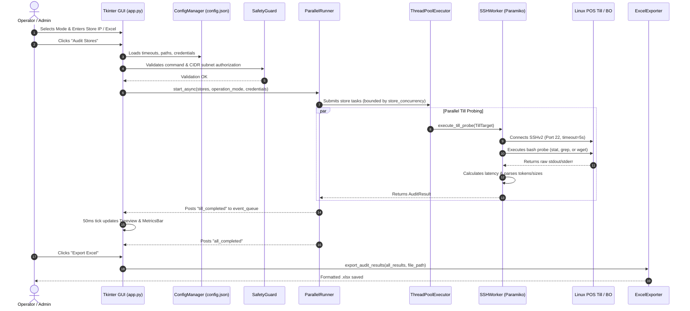

# POS Operations Hub / Enterprise System Checker - Comprehensive Codebase Architecture & Technical Reference

> **Document Purpose:** This document provides an exhaustive, low-level technical explanation of the entire codebase, internal data structures, concurrency mechanics, security guardrails, network communication protocols, and user interface workflows. It is authored specifically to give another AI or senior software engineer a complete, implementation-grade mental model of the software without requiring them to read every raw source file.

---

## Table of Contents
1. [High-Level Architecture & Design Philosophy](#1-high-level-architecture--design-philosophy)
2. [Project File Map & Module Responsibilities](#2-project-file-map--module-responsibilities)
3. [Domain Models & Data Structures (`models/`)](#3-domain-models--data-structures-models)
   - [3.1 `models/target.py`: Target Resolution & Store Records](#31-modelstargetpy-target-resolution--store-records)
   - [3.2 `models/result.py`: Audit Statuses, Results & Summaries](#32-modelsresultpy-audit-statuses-results--summaries)
4. [Security & Safety Engine (`core/safety_guard.py`)](#4-security--safety-engine-coresafety_guardpy)
   - [4.1 4-Tier Read-Only Defense on Back Office (.15)](#41-4-tier-read-only-defense-on-back-office-15)
   - [4.2 Controlled In-Place Configuration Modification on Tills (.112+)](#42-controlled-in-place-configuration-modification-on-tills-112)
   - [4.3 Universal Attack Defenses & Command Whitelisting](#43-universal-attack-defenses--command-whitelisting)
   - [4.4 HTTP & Tender URL Validation](#44-http--tender-url-validation)
5. [Configuration & State Persistence (`core/config_manager.py`)](#5-configuration--state-persistence-coreconfig_managerpy)
6. [Concurrency & Parallel Execution Engine (`core/`)](#6-concurrency--parallel-execution-engine-core)
   - [6.1 `core/parallel_runner.py`: Sliding Window Batch Orchestrator](#61-coreparallel_runnerpy-sliding-window-batch-orchestrator)
   - [6.2 `core/ssh_worker.py`: Multi-Candidate Paramiko SSH Worker](#62-coressh_workerpy-multi-candidate-paramiko-ssh-worker)
7. [Probe Construction & File Inspection (`core/file_checker.py`)](#7-probe-construction--file-inspection-corefile_checkerpy)
   - [7.1 Remote Bash Probe Construction](#71-remote-bash-probe-construction)
   - [7.2 Decimal vs. Binary MB Size Mathematics](#72-decimal-vs-binary-mb-size-mathematics)
   - [7.3 Delivery Token Regex Extraction](#73-delivery-token-regex-extraction)
8. [Storage, Parsing & Reporting Engine (`storage/`)](#8-storage-parsing--reporting-engine-storage)
   - [8.1 `storage/store_reader.py`: Ingestion & Zip-Bomb Protected XLSX Parsing](#81-storagestore_readerpy-ingestion--zip-bomb-protected-xlsx-parsing)
   - [8.2 `storage/excel_exporter.py`: OpenPyXL Formatted Export](#82-storageexcel_exporterpy-openpyxl-formatted-export)
   - [8.3 `storage/csv_exporter.py`: CSV Export](#83-storagecsv_exporterpy-csv-export)
9. [User Interface Architecture (`ui/`)](#9-user-interface-architecture-ui)
   - [9.1 `ui/app.py`: Main Application Loop & Reactive Event Polling](#91-uiapppy-main-application-loop--reactive-event-polling)
   - [9.2 `ui/components/mode_card.py`: Tabbed Mode Controller & Autocomplete](#92-uicomponentsmode_cardpy-tabbed-mode-controller--autocomplete)
   - [9.3 `ui/components/results_table.py`: Dynamic Treeview & Anti-Lag Viewport](#93-uicomponentsresults_tablepy-dynamic-treeview--anti-lag-viewport)
   - [9.4 Other UI Components (`target_card`, `credentials_card`, `metrics_bar`, `filter_toolbar`)](#94-other-ui-components)
10. [End-to-End Execution Sequence](#10-end-to-end-execution-sequence)
11. [Guide for AI Extensions & Modifications](#11-guide-for-ai-extensions--modifications)

---

## 1. High-Level Architecture & Design Philosophy

The application is an **Enterprise POS Operations & Audit Console** built with Python and Tkinter. It manages, inspects, and modifies Linux-based Point-of-Sale (POS) store networks across retail chains.

### Core Constraints & Invariants
1. **Network Environment:** Retail store networks are WAN-connected with low bandwidth (10–20 Mbps). Opening hundreds of unthrottled SSH connections saturates store routers and drops till billing sessions. Hence, concurrency is strictly bounded.
2. **Dual-Tier Fleet Hierarchy:** Each store has two distinct classes of Linux devices:
   - **Back Office (BO Server):** Typically fixed at offset `.15` (e.g., `10.x.x.15`). Holds the store database, central inventory, and backend applications (`ETPBackOffice`). **Security Policy:** Strictly 100% Read-Only; write commands are physically blocked in code.
   - **POS Tills (Counters 1..N):** IP offset typically starting at `.112` through `.112 + count` (e.g., `10.x.x.112` for Till-01). They run the front-of-store POS billing application (`ETPStoreFront`). **Security Policy:** Read-only inspection plus strictly validated in-place configuration file updates.
3. **Deterministic FCFS Ordering:** Multi-threaded parallel probes return out-of-order due to network jitter. The UI table and exports strictly reorganize results into deterministic hierarchy: `Store -> Store BO -> Till 1 -> Till 2 -> ... -> Till N`.
4. **Anti-Lag Viewport:** 14-inch enterprise laptops lag or crash when rendering thousands of rows in Tkinter Treeview. The UI caps active rendering to `100` rows while preserving 100% of audit data in memory for Excel/CSV exports.
5. **Zero Credential Leakage:** Passwords are scrubbed from all in-memory dictionaries, event payloads, and `config.json` before persistence.

```
+-----------------------------------------------------------------------------------+
|                              Desktop UI (Tkinter)                                 |
|  [TargetCard]       [CredentialsCard]       [ModeCard]        [FilterToolbar]     |
|         \                  |                   /                     /            |
|          \                 v                  /                     /             |
|           +-----> [ui/app.py (Controller)] <-+                     /              |
|                     |        ^                                    /               |
|            Schedule |        | 50ms Queue Polling                /                |
|                     v        |                                  v                 |
|             [BatchOrchestrator / ParallelRunner] ----> [ResultsTable (Treeview)]   |
+---------------------|-------------------------------------------------------------+
                      | Multi-Threaded Workers (Sliding Window, Max 100 SSH)
                      v
      +-------------------------------+-------------------------------+
      |                                                               |
      v                                                               v
[Store A: BO (.15)] (Read-Only)                     [Store A: Tills (.112..N)]
- WAR verification                                  - WAR & Properties check
- HTTP tender URL check                             - In-place property update (.bak)
- System diagnostics                                - Terminal commands & URLs
```

---

## 2. Project File Map & Module Responsibilities

```
tills/
├── main.py                     # Application entry point, high-DPI scaling, Tk initialization
├── config.json                 # Persistent local JSON configuration (scrubbed of passwords)
├── models/
│   ├── target.py               # TillTarget & StoreRecord domain models, IP/UAT target resolution
│   ├── result.py               # AuditResult, AuditSummary, AuditStatus (Success, Offline, etc.)
│   └── __init__.py
├── core/
│   ├── safety_guard.py         # Multi-tier command validator, 100% read-only BO guard, regex checks
│   ├── config_manager.py       # Thread-safe persistent JSON config manager with schema sanitization
│   ├── file_checker.py         # Remote bash probe generation, size math (decimal MB), delivery tokens
│   ├── probe_engine.py         # Backward-compatibility alias re-exporting file_checker
│   ├── ssh_worker.py           # Paramiko SSH worker, multi-candidate credential fallbacks, probes
│   ├── parallel_runner.py      # Sliding-window concurrency engine (1-10 stores, max 100 SSH conns)
│   ├── batch_orchestrator.py   # Backward-compatibility alias re-exporting ParallelRunner
│   ├── crypto_utils.py         # Credential helpers and obfuscation utilities
│   └── __init__.py
├── storage/
│   ├── store_reader.py         # Excel (.xlsx) / CSV parser with Zip Bomb & memory exhaustion defense
│   ├── excel_exporter.py       # OpenPyXL production Excel export with colors, borders, freeze panes
│   ├── csv_exporter.py         # Fast CSV export of results and failed re-test lists
│   └── __init__.py
├── ui/
│   ├── app.py                  # Main Tkinter controller, event consumer, async execution lifecycle
│   ├── theme.py                # Color palette, font styles, geometry constants
│   ├── components/
│   │   ├── target_card.py      # Single IP, UAT mode, specific tills input, store queue management
│   │   ├── credentials_card.py # Username/password fields, show/hide toggle, connection test
│   │   ├── mode_card.py        # 3 operational modes (File Check, Version Check, Terminal Console)
│   │   ├── results_table.py    # Treeview results grid, anti-lag 100-row cap, dynamic columns
│   │   ├── metrics_bar.py      # Summary metrics: Total, Completed, Success, Mismatch, Offline, Pass %
│   │   ├── filter_toolbar.py   # Status filter tabs (All/Success/Mismatch/Offline), search, exports
│   │   ├── output_dialog.py    # Large text inspector popup for command stdout/stderr
│   │   └── __init__.py
│   └── __init__.py
```

---

## 3. Domain Models & Data Structures (`models/`)

### 3.1 `models/target.py`: Target Resolution & Store Records

#### `TillTarget` Dataclass
Represents a single concrete endpoint (a single Till counter or Back Office server):
```python
@dataclass
class TillTarget:
    store_code: str         # e.g., "Store-001" or "UAT-Delhi"
    till_name: str          # e.g., "Till-01" or "BO-01"
    till_num: int           # Integer counter index (0 for BO, 1..N for Tills)
    ip: str                 # Exact resolved IP (e.g., "10.14.22.112")
    port: int = 22          # SSH port
    store_order_index: int = 0  # Ingestion sequence index (for FCFS ordering)
    is_bo: bool = False     # True if Back Office (.15), False if Till
    device_type: str = "TILL" # "TILL" or "BO"
    extra: Dict[str, Any] = field(default_factory=dict)
```

#### `StoreRecord` Dataclass & Resolution Algorithm
Represents an entire store containing a Back Office server and multiple POS tills.
```python
@dataclass
class StoreRecord:
    store_code: str
    subnet_or_ip: str       # Base IP or subnet prefix, e.g. "10.14.22." or "10.14.22.12"
    till_count: int = 13    # Default tills per store (configured up to 100)
    start_offset: int = 112 # Starting IP offset for Till-01
    store_order_index: int = 0
    specific_tills: str = "" # e.g., "1, 2, 5-8"
    include_tills: bool = True
    include_bo: bool = False
    is_uat: bool = False    # When True, disables offset math; uses exact IP entered
```

#### Target Resolution Logic (`resolve_targets()`):
The resolver transforms a `StoreRecord` into a flat list of `TillTarget` objects following Section 8.1 hierarchy:
1. **Loopback Mode:** If IP starts with `127.` or `localhost`, targets local machine ports.
2. **UAT Mode:** If `is_uat=True` or `"uat"` is in `store_code`, it **never** appends `.15` or `.112`. It strictly uses the exact IP entered in the UI.
3. **Production Mode (Offset Math):**
   - Extract the `/24` base subnet (e.g. `10.14.22.` from `10.14.22.12`).
   - If `include_bo=True`: Generates `BO-01` at offset `.15` (`10.14.22.15`).
   - If `include_tills=True`:
     - If `specific_tills` is specified (e.g. `"1, 3, 5"`), parses ranges (`1-4`) and generates only those tills.
     - Otherwise, loops `i` from `1` to `till_count` (e.g., 1 to 13), setting IP to `base + (start_offset + i - 1)` (e.g., Till 1 = `.112`, Till 2 = `.113`, ..., Till 13 = `.124`).

---

### 3.2 `models/result.py`: Audit Statuses, Results & Summaries

#### The 5 Master Status States (`AuditStatus`)
```python
class AuditStatus:
    SUCCESS = "Success"     # Version matches, file exists, or command returned 0
    OFFLINE = "Offline"     # SSH connection refused, timeout, or auth failure
    MISMATCH = "Mismatch"   # WAR file size differs (>0.3 MB) or delivery token differs
    MISS = "Miss"           # Required file or properties key does not exist on disk
    BLOCKED = "Blocked"     # SecurityGuard intercepted forbidden command / injection
```

#### `AuditResult` Dataclass
Represents the complete execution output of a single target:
- `store_code`, `till_name`, `till_num`, `ip`, `store_order_index`, `is_bo`.
- `latency_ms`: Round-trip SSH execution time in milliseconds.
- `war_size`, `war_size_bytes`, `war_expected_bytes`, `war_modified`.
- `delivery_version`: Extracted delivery token (e.g. `"81A"`).
- `prop_variable`, `expected_version`.
- `preview_output`: 1-line string rendered inside the UI table cells.
- `full_output`: Complete raw stdout/stderr string (viewed in Terminal or OutputDialog).

---

## 4. Security & Safety Engine (`core/safety_guard.py`)

This module enforces enterprise protection against destructive commands, accidental outages, and data tampering.

```
                              Incoming Command String
                                        |
                 +----------------------+----------------------+
                 |                                             |
         Target is BO (.15)?                           Target is Till?
                 |                                             |
                 v                                             v
    +--------------------------+                 +---------------------------+
    | 100% Read-Only Guard     |                 | Controlled Config Write?  |
    | Tier 1: No Redirections  |                 | (grep -> sed -i -> echo)  |
    | Tier 2: No Pipe Writers  |                 +-------------+-------------+
    | Tier 3: No Modifying App |                               |
    | Tier 4: No Script Evals  |                Yes            | No
    +-------------+------------+                 v             v
                  |                      [Allow Write]   [Check Whitelist]
                  v                                            |
         [Enforce Whitelist] <---------------------------------+
                  |
                  v
         [Universal Defenses]
         - Block Reverse Shells (nc, socat, /dev/tcp)
         - Block OS Targets (/etc/shadow, /etc/sudoers)
         - Block Privilege Escalation (sudo su, visudo)
         - Block Command Substitution ($(), ``)
```

### 4.1 4-Tier Read-Only Defense on Back Office (.15)
Back Office servers house critical store databases. Any write command on BO is rejected with `AuditStatus.BLOCKED`:
- **Tier 1 (Redirection Filter):** Blocks `>`, `>>`, `>|`, `&>`, `1>`, `2>`. (Preserves `2>&1` for stderr merging).
- **Tier 2 (Pipe Writers):** Blocks commands piping into `tee` or `dd`.
- **Tier 3 (Modifying Utilities):** Blocks `rm`, `truncate`, `touch`, `cp`, `mv`, `chmod`, `chown`, `kill`, `pkill`, `apt`, `dpkg -i`, `reboot`, `shutdown`, `sed -i`, and `systemctl restart/stop`.
  *(Exception: `last reboot` is explicitly allowed as it audits past reboots).*
- **Tier 4 (Script & Eval Filter):** Blocks `python -c`, `eval`, and `exec`.

### 4.2 Controlled In-Place Configuration Modification on Tills (.112+)
To allow updating properties (e.g., `timeout=100000`) on tills without opening an unrestricted shell, `is_valid_till_config_write()` validates that the command strictly adheres to this verified template:
```bash
FILE="/path/to/app.properties"
if grep -q "^<key>=" "$FILE"; then
    sed -i 's/^<key>=.*/<key>=<val>/' "$FILE"
else
    echo "<key>=<val>" >> "$FILE"
fi
grep "^<key>=" "$FILE"
```
If the command matches this template and contains no forbidden destructive binaries, it is permitted on Tills. **It is always blocked on BO.**

### 4.3 Universal Attack Defenses & Command Whitelisting
Active on all targets (BO and Tills):
1. **Reverse Shell & Socket Defense:** Regex blocks `\bnc\s+-e\b`, `\bsocat\b`, `/dev/tcp/`, `socket` imports.
2. **Protected OS Targets:** Blocks commands touching `/etc/shadow`, `/etc/sudoers`, `/dev/sda`, `/boot/`.
3. **Privilege Escalation:** Blocks `su -`, `sudo su`, `sudo -i`, `visudo`, `passwd`.
4. **Command Substitution Injection:** Blocks `$()` and backticks ``` `` ``` to prevent subshell command hiding.
5. **Whitelist Verification:** Every piped segment in every command chain (separated by `;`, `&&`, `||`, `|`) must resolve to a known safe utility (e.g., `grep`, `awk`, `cat`, `stat`, `df`, `free`, `uptime`, `wget`, `dotnet`, `java`).

### 4.4 HTTP & Tender URL Validation
When testing URLs (e.g. `wget https://pinelab.payment.internal/api/health`):
- Permits `wget` commands containing comma-separated URLs.
- On BO: Blocks downloading files to disk (`-O filename` is blocked; output to stdout or `/dev/null` is allowed).
- Chained destructive commands appended to URLs are scrubbed and blocked.

---

## 5. Configuration & State Persistence (`core/config_manager.py`)

`ConfigManager` provides thread-safe access to `config.json` via a re-entrant `threading.Lock()`:

### Key Configuration Schema (`DEFAULT_CONFIG`)
| Field | Type | Default | Description |
| :--- | :--- | :--- | :--- |
| `till_username` | `str` | `"posuser"` | Default SSH username for Tills |
| `bo_username` | `str` | `"boadmin"` | Default SSH username for Back Office |
| `default_port` | `int` | `22` | Standard SSH port |
| `default_start_ip_offset`| `int` | `112` | Start offset for Till-01 |
| `default_till_count` | `int` | `13` | Default count of tills per store |
| `connection_timeout_seconds`| `int` | `5` | Socket connect timeout (1–30s) |
| `store_concurrency` | `int` | `1` | Stores audited in parallel (1–10) |
| `max_workers_per_store` | `int` | `16` | Thread limit per store |
| `size_tolerance_mb` | `float`| `0.3` | File size match tolerance (+/- MB) |
| `max_display_rows` | `int` | `100` | Treeview viewport row cap |
| `saved_file_paths` | `List[str]` | `[...]` | Recent paths populated in Comboboxes |
| `tender_urls` | `Dict[str, str]`| `{...}` | Aliases for Tab autocompletion |

### Safety Invariant
`_validate_and_sanitize()` and `save()` strictly strip any key containing `"pass"` (case-insensitive) to ensure credentials can **never** be persisted to disk.

---

## 6. Concurrency & Parallel Execution Engine (`core/`)

### 6.1 `core/parallel_runner.py`: Sliding Window Batch Orchestrator

The concurrency engine coordinates multi-store batch execution across hundreds of remote POS terminals without overloading store WAN routers.

```
Pending Stores Queue: [Store 1, Store 2, Store 3, Store 4, ...]
                           |
                           v
          [Active Store Window: Capacity = 1 to 10]
          +-----------------------+-----------------------+
          | Store 1: 15 Tills     | Store 2: 12 Tills     |  Total Active SSH = 27
          +-----------------------+-----------------------+  (Global Cap = 100)
                           |
               ThreadPoolExecutor (Workers)
              /     |     |     |     |     \
            Till1 Till2 Till3 Till4 Till5 ... BO
```

#### Execution Lifecycle:
1. `start_async()` launches `_run_orchestration()` in a dedicated daemon thread.
2. Targets are resolved for all stores. Total expected till count is calculated.
3. **Sliding Window Admission:**
   - Stores are admitted from `pending_stores` into `active_stores` while `len(active_stores) < store_concurrency` AND `active_connections + store_tills <= max_total_ssh_connections`.
   - Each till task is submitted to a global `ThreadPoolExecutor(max_workers=min(100, max(total, 10)))`.
4. As each worker completes:
   - It decrements `active_connections`.
   - Posts `till_completed` event into the thread-safe `event_queue`.
   - When all tills for a store complete, the store is removed from `active_stores`, signalling the condition variable `_cond.notify_all()` to admit the next waiting store.
5. **Flow Control:** Supports thread-safe `pause()`, `resume()`, and `stop()` via `threading.Event()` flags.

---

### 6.2 `core/ssh_worker.py`: Multi-Candidate Paramiko SSH Worker

`execute_till_probe()` manages the SSH connection lifecycle to a single target:

#### 1. Multi-Candidate Credential Fallback Matrix
Retail stores often have mismatched passwords during migration windows. To prevent false "Offline" alarms, the worker builds a prioritized candidate list:
1. `(primary_user, primary_pass)`
2. `(alt_user, primary_pass)`
3. `(primary_user, alt_pass)`
4. `(alt_user, alt_pass)`
It tries candidate credentials sequentially. If candidate 1 fails with `paramiko.AuthenticationException`, it immediately attempts candidate 2 before declaring failure.

#### 2. Strict Socket Timeouts & Keepalive
- `timeout`: Connect socket timeout (default 5 seconds).
- `banner_timeout`: Max 15s (prevents hanging on slow WAN banners).
- `auth_timeout`: Max 15s.
- `look_for_keys=True`, `allow_agent=True` for key-based authentication.

#### 3. Command Execution & Result Compilation
- Opens an SSH channel: `client.exec_command(probe_cmd, timeout=timeout)`.
- Measures exact network latency: `latency_ms = (perf_counter() - start) * 1000`.
- Routes raw stdout/stderr to `file_checker.py` parser or tender URL regex parser.
- Ensures `client.close()` runs in a `finally` block to release socket descriptors.

---

## 7. Probe Construction & File Inspection (`core/file_checker.py`)

### 7.1 Remote Bash Probe Construction
`build_version_war_probe(war_path, prop_path, variable_name)` generates a compact, high-efficiency, single-line remote shell probe that executes atomically on the target counter:

```bash
echo "===WAR_STAT===";
if [ -f "/home/posuser/app.war" ]; then
    stat -c "%s %Y" "/home/posuser/app.war" 2>/dev/null || stat -f "%z %m" "/home/posuser/app.war" 2>/dev/null;
else
    echo "NOT_FOUND";
fi;
echo "===PROP_VAL===";
if [ -f "/home/posuser/config.properties" ]; then
    grep -i "^[[:space:]]*timeout[[:space:]]*=" "/home/posuser/config.properties" 2>/dev/null | head -n 1;
else
    echo "NOT_FOUND";
fi
```
The output is split using the delimiters `===WAR_STAT===` and `===PROP_VAL===`.

---

### 7.2 Decimal vs. Binary MB Size Mathematics

Retail Ubuntu desktop file managers display file sizes in **decimal Megabytes** ($1\text{ MB} = 1,000,000\text{ bytes}$), whereas Linux `ls -lh` displays **binary Mebibytes** ($1\text{ MiB} = 1,048,576\text{ bytes}$). This discrepancy frequently causes false mismatch alerts.

`file_checker.py` solves this completely:
1. **Human Display (`format_bytes_human`):**
   $$\text{MB} = \frac{\text{bytes}}{1,000,000.0}$$
   Formatted to 1 decimal place (e.g. `240.5 MB`).
2. **Tolerance Evaluation (`evaluate_size_match`):**
   Parses expected input into both decimal bytes (`val * 1,000,000`) and binary bytes (`val * 1,048,576`).
   Evaluates:
   $$|\text{actual\_bytes} - \text{dec\_exp}| \le \text{tolerance\_bytes} \quad\lor\quad |\text{actual\_bytes} - \text{bin\_exp}| \le \text{tolerance\_bytes}$$
   Default tolerance is $0.3\text{ MB}$ ($314,572\text{ bytes}$). If within tolerance, size is certified as **Matched**.

---

### 7.3 Delivery Token Regex Extraction

In ETP retail software, delivery tokens appear in diverse formats inside properties files:
- `patch(delivery 75A)` $\to$ `"75A"`
- `ts0034 = Patch 53 Delivery No 81A` $\to$ `"81A"`
- `Delivery No 79` $\to$ `"79"`
- `delivery: 23` $\to$ `"23"`

#### Extraction Strategy (`extract_trailing_delivery_token`):
1. **Primary Match:** Looks for the alphanumeric token immediately following the `delivery` keyword:
   `r'(?i)\bdelivery\s*(?:no\.?|num\.?|number|version)?\s*[:=-]?\s*([0-9a-zA-Z]+)'`
2. **Trailing Match:** If the keyword `delivery` is absent, extracts the trailing alphanumeric token at the end of the line.
3. Both actual and expected tokens are converted to uppercase and compared. If equal, status is certified as **Matched**.

---

## 8. Storage, Parsing & Reporting Engine (`storage/`)

### 8.1 `storage/store_reader.py`: Ingestion & Zip-Bomb Protected XLSX Parsing
Reads bulk store lists from `.xlsx` or `.csv`.
- **Zip-Bomb & Memory Exhaustion Defenses:**
  - Hard cap on compressed `.xlsx` file size: $50\text{ MB}$.
  - Zip entry count cap: Max 100 internal files in archive.
  - Total uncompressed XML stream cap: Max $50\text{ MB}$.
  - Uses streaming `xml.etree.ElementTree` parsing without loading full documents into memory.
- **CIDR Subnet Authorization:**
  Before admitting any IP into the execution queue, `is_ip_authorized()` checks it against authorized enterprise private networks (`10.0.0.0/8`, `192.168.0.0/16`, `172.16.0.0/12`, `127.0.0.0/8`). Public IPs are rejected immediately.

---

### 8.2 `storage/excel_exporter.py`: OpenPyXL Formatted Export
Generates audit reports matching Microsoft Excel standards:
- **Sheet 1: Audit Results**
  - Styled headers: Deep Navy `#1E3A8A` background with white bold text.
  - Dynamic column layout depending on operation mode (File Check vs. Version Check vs. Terminal).
  - Status cells color-coded:
    - **Success / Matched:** Soft Green `#DCFCE7` with Dark Green `#15803D` text.
    - **Mismatch:** Soft Red `#FEE2E2` with Dark Red `#B91C1C` text.
    - **Offline:** Soft Amber `#FEF3C7` with Dark Amber `#B45309` text.
  - Frozen top pane (`freeze_panes = "A2"`).
  - Auto-fitted column widths based on maximum string lengths + padding.
- **Failed Machines Re-Test List:**
  Exports a ready-to-run `.csv` containing only the offline and mismatched counters, enabling 1-click targeted re-audits.

---

## 9. User Interface Architecture (`ui/`)

### 9.1 `ui/app.py`: Main Application Loop & Reactive Event Polling
The main window runs on Tkinter's standard thread. To prevent UI freezes during heavy multi-threaded SSH activity, the UI **never** touches worker threads directly.

#### Event Polling Mechanism:
1. `ParallelRunner` posts events to `event_queue`.
2. `MainApp` schedules `self._poll_events()` every **50 milliseconds** via `root.after(50, self._poll_events)`.
3. In each 50ms tick, it drains up to 50 events from the queue and dispatches them to UI components:
   - `"till_completed"` $\to$ updates `ResultsTable`, updates `MetricsBar`.
   - `"store_admitted"` $\to$ updates active store status in logs.
   - `"all_completed"` $\to$ toggles Audit button back to "Audit Stores", plays notification.

---

### 9.2 `ui/components/mode_card.py`: Tabbed Mode Controller & Autocomplete
Presents 3 operation modes via dedicated buttons:
1. **📁 File Check:** Checks file path, size tolerance, and raw property values.
2. **🏷️ Version Check:** Extracts delivery tokens; updates aggregated Version Check table.
3. **⚡ Terminal:** Dark Linux terminal screen (`#0A0E17`) for executing diagnostic commands and probing tender URLs.

#### Autocomplete Feature:
- When typing in the Terminal command entry, pressing <kbd>Tab</kbd> detects tender aliases (e.g., `pine`) and auto-expands them to full URLs (`https://pinelab.payment.internal/api/health`).
- All typed file paths automatically persist into `saved_file_paths` inside `config.json` and appear in dropdown comboboxes across application restarts.

---

### 9.3 `ui/components/results_table.py`: Dynamic Treeview & Anti-Lag Viewport

#### The 100-Row Viewport Cap:
Tkinter Treeview lags when holding $>500$ rows. `ResultsTable` maintains:
- `self.all_results: List[AuditResult]` $\to$ 100% of audit data in memory.
- `self.displayed_items` $\to$ Capped at `max_display_rows` (default 100).
- If results exceed 100, the table renders the first 100 and shows a notification badge: *"Showing 100 of 450 rows (All data preserved for Excel export)"*.

#### Version Check Mode (5-Column Aggregation):
In Version Check mode, the table collapses till rows into a single aggregated row per store:
```
+------------+----------------+--------------------+------------------+---------+
| Store Code |   BO IP (.15)  |  Mismatch Version  |     Offline      | Status  |
+------------+----------------+--------------------+------------------+---------+
| Store-001  |  10.14.22.15   |  All Matched       |  -               | Success |
| Store-002  |  10.14.23.15   |  Till-03, Till-07  |  Till-12         | Mismatch|
| Store-003  |  10.14.24.15   |  -                 |  All Offline     | Offline |
+------------+----------------+--------------------+------------------+---------+
```

---

## 10. End-to-End Execution Sequence



---

## 11. Guide for AI Extensions & Modifications

When instructing an AI to modify this codebase, provide these specific rules:

### Rule 1: Never Break the Back Office Read-Only Invariant
Any new feature that executes remote commands must pass through `SafetyGuard.validate_command(cmd, is_bo=target.is_bo)`. If `target.is_bo` is `True`, write utilities and file redirections are strictly illegal.

### Rule 2: Keep Concurrency Bounded
Never spawn unbounded raw threads (`threading.Thread`) per till. All network connections must go through `ParallelRunner` so that global SSH connections remain capped at `100` and store concurrency respects `store_concurrency` (1–10).

### Rule 3: Maintain Deterministic Ordering
When displaying or exporting results, always sort using `target.store_order_index` and `target.till_num`. The required sequence is always:
$$\text{Store}_1 \longrightarrow \text{Store}_1\text{ BO} \longrightarrow \text{Till } 1 \dots N \longrightarrow \text{Store}_2 \longrightarrow \dots$$

### Rule 4: Handle Both Decimal and Binary Sizes
When checking file sizes, always use `evaluate_size_match()` from `core/file_checker.py`. Never do a strict integer equality check (`actual == expected`), because Linux file systems report decimal MB vs binary MiB differently.

### Rule 5: Keep the UI Non-Blocking
Never call `time.sleep()`, synchronous socket operations, or `paramiko.connect()` on the main Tkinter thread. All background work must communicate via `self.post_event()` and be consumed by `_poll_events()`.

---
*End of Technical Reference Document.*

