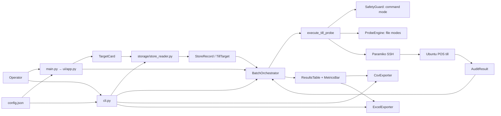

# File Inspector: Current Codebase Reference

**Purpose:** This is the single handoff document for a developer or AI working on this repository. It inventories the current source code, data contracts, execution paths, configuration, change impact, and verified security gaps.

**Scope:** Source inspected in the working tree on 2026-09-27. The source code is authoritative if it conflicts with this document.

> Important: `README.md`, `ARCHITECTURE.md`, and `architecture.json` contain older descriptions. They describe several behaviours that are not implemented in the current source, including active command-shell blocking and GUI use of configured CIDRs; they also mention a `gui.py` launcher that is not present. Do not rely on them for security decisions.

## 1. What the application does

This is a Tkinter desktop tool with a CLI alternative. It expands a store/subnet list into POS-till targets, connects to each target with Paramiko SSH, and runs one of three modes:

1. `file_check`: retrieves file existence, file size, modification time, and full unstripped property value.
2. `version_check`: strips prefix to extract trailing delivery number token (e.g. '81A') and performs strict exact matching; outputs aggregated 5-column store report (`Store Code, IP, Mismatch Version, Offline, Status`).
3. `terminal`: executes user-supplied diagnostic commands or wget probes with strict command output table.

It returns an `AuditResult` per till, displays results in the GUI, and exports CSV or a zero-dependency OpenXML workbook.

## 2. Real execution paths



### GUI audit sequence

1. `main.py` imports and calls `ui.app.main()`.
2. `FileCheckerApp` loads `config.json`, constructs its cards and starts a 50 ms UI event loop.
3. `TargetCard` supplies one `StoreRecord`, imported records, or pasted records.
4. `ModeCard` and `CredentialsCard` provide mode parameters and the SSH password.
5. `FileCheckerApp._start_audit()` creates `BatchOrchestrator` and calls `start_async()`.
6. The orchestrator resolves every store to `TillTarget` instances, schedules workers, and emits events through `event_queue`.
7. `FileCheckerApp._process_events()` consumes `result`, `target_summary`, and `completed` events, then updates the table and KPI bar.

### CLI audit sequence

1. `cli.main()` parses flags, reads `POS_SSH_PASSWORD` or prompts securely, and loads `config.json`.
2. `load_stores_from_file()` imports and CIDR-checks targets using the configured `allowed_subnets`.
3. The same `BatchOrchestrator` runs the audit; the CLI prints only `result` events and exports reports when requested.

## 3. Data contracts and configuration

### Core models

| Type | Key fields | Produced by | Consumed by |
|---|---|---|---|
| `StoreRecord` | `store_code`, `subnet_or_ip`, `till_count`, `specific_tills`, `direct_targets`, `store_order_index` | TargetCard and store reader | BatchOrchestrator |
| `TillTarget` | `store_code`, `till_name`, `till_num`, `ip`, `port`, `store_order_index` | `StoreRecord.resolve_targets()` or re-audit import | SSH worker |
| `AuditResult` | target identity, status, latency, file/version fields, preview/full output, timestamp | SSH worker | Orchestrator, GUI, exporters |
| `AuditSummary` | totals by status, elapsed time | BatchOrchestrator | MetricsBar, exporters, CLI |

### `config_params` passed to `execute_till_probe`

| Key | Used by | Meaning |
|---|---|---|
| `operation_mode` | app/CLI/orchestrator | `version_war`, `file_info`, or `command` |
| `war_path`, `war_expected_size_bytes` | version mode | Remote WAR path and expected size input |
| `properties_path`, `properties_keyword`, `expected_delivery_version` | version mode | Remote `.properties` probe and expected delivery version |
| `file_info_path` | file-info mode | Remote file to inspect |
| `custom_command`, `cmd_expected_output` | command mode | Remote diagnostic command and optional expected text |
| `size_tolerance_mb` | GUI worker path | Size tolerance converted to bytes by `ssh_worker.py` |

### Persistent configuration

`core/config_manager.py` owns defaults and persistence. It removes any key containing `pass` while loading/saving, clamps timeout to 1–30 seconds and persisted store concurrency to 1–5, and accepts only keys already declared in `DEFAULT_CONFIG` during load.

`config.json` currently also declares `allowed_subnets` and `allowed_commands`. These are not equivalent controls:

- `allowed_subnets` is passed by the **CLI** to the store reader. The GUI bulk importer uses reader defaults instead; the GUI single-store path enforces `is_ip_authorized()` across both "Start Audit" and single-store Terminal Console execution.
- `allowed_commands` is not passed to `SafetyGuard.validate_command()`. Command mode uses the hard-coded `DEFAULT_WHITELIST` in `core/safety_guard.py`.

## 4. File map and function catalogue

### Entrypoints and build

| File | Functions / behaviour | Called by / change impact |
|---|---|---|
| `main.py` | Top-level bootstrap only: adds repository root to `sys.path`, imports `ui.app.main`, then calls it. | Main GUI entry point. Keep it minimal; changing import paths can prevent startup. |
| `cli.py` | `main()`: parses CLI flags, obtains password from `POS_SSH_PASSWORD` or `getpass`, loads config/targets, creates the orchestrator, prints results, and optionally exports files. | Used by scheduled/headless runs. `--port` is parsed but currently unused. `size_tolerance_bytes` is written to params, but worker code reads `size_tolerance_mb`, so the CLI tolerance setting is not currently applied. |
| `build_exe.py` | `build()`: invokes PyInstaller with `--onefile` and `--windowed`, producing `dist/FileInspector.exe`. | Called directly or by `build_exe.bat`. Alter flags only after testing the packaged executable. |
| `build_exe.bat` | Activates `venv`, installs PyInstaller, then runs `build_exe.py`. | Build convenience script. It installs an unpinned package from the configured Python package index. |

### `core/config_manager.py`

| Function | Responsibility | Key connections |
|---|---|---|
| `ConfigManager.__init__(config_file_path)` | Stores the path, creates a lock, and loads configuration. | Created by `FileCheckerApp` and CLI. |
| `_validate_and_sanitize(raw_data)` | Accepts configured known keys/types, omits password-named keys, applies timeout/concurrency/tolerance clamps, and restores empty allow-lists to defaults. | Called only while loading from disk. |
| `_load()` | Reads JSON then validates it; falls back to `DEFAULT_CONFIG` on error. | Called by constructor. Exceptions are intentionally swallowed. |
| `get(key, default)` | Thread-safe value lookup. | Used for GUI/CLI defaults. |
| `set(key, value)` | Updates one in-memory key unless its name contains `pass`. | Not used by current GUI. Unlike load, it does not validate type/range. |
| `update(mapping)` | Updates in-memory values excluding password-named keys. | `FileCheckerApp._save_current_config()` uses this. It also does not validate type/range. |
| `save()` | Writes a password-free JSON configuration. | Called on audit start and window close. |
| `get_all()` | Returns a shallow copy of config. | GUI config population. |

### `core/safety_guard.py`

| Item | Responsibility | Key connections |
|---|---|---|
| `DEFAULT_WHITELIST` | Hard-coded allowed program names for command mode (39 inspection tools). | Used by `validate_command()`, not by file modes. |
| `SafetyGuard.validate_command(cmd, is_bo=False, extra_allowed=None)` | Enforces Section 1.1 (Tills) and 1.2 (Back Office 100% read-only). Splits on statements and pipes, tokenizes with `shlex`, validates allow-list, blocks shell redirection/privileged binaries, and guards against chained URL injection (`if not any(sep in clean_cmd for sep in [";", "&&", "||", "\n", "`", "$("]))`). | Called in SSH command mode and terminal execution. |

### `core/file_checker.py` (aliased as `core/probe_engine.py`)

| Function | Responsibility | Used by |
|---|---|---|
| `format_bytes_human(num_bytes)` | Formats bytes as decimal MB or `-`. | Parsers, previews, reports. |
| `sanitize_file_path(p)` | Removes CR, LF, and NUL before shell quoting. | Both remote file probes. |
| `sanitize_keyword(kw)` | Removes non-word/non-dot/non-hyphen characters; uses `TS00046` when blank. | Version probe construction. |
| `parse_expected_size_safe(exp_input)` | Converts raw bytes or values such as `184.5 MB` to decimal/binary byte expectations. | Size match evaluation. |
| `evaluate_size_match(actual_bytes, exp_input, tolerance_bytes)` | Accepts a value within tolerance against decimal or binary interpretations and returns `(matched, representative_expected_bytes)`. | Version parser. |
| `extract_delivery_token(val)` | Extracts a standalone delivery token such as `75A`. | Strict version matching. |
| `extract_delivery_info(raw_prop_val)` | Produces `(delivery_number, display_string)`, including optional patch number. | Version parser / UI display. |
| `matches_delivery_version(actual_val, expected_input)` | Performs blank-pass, exact, delivery-token, then boundary matching. | Version parser. |
| `FileChecker.build_version_war_probe(war_path, prop_path, keyword)` | Builds one quoted shell command to collect WAR data and one matching property line, returning `WAR|...|PROP|...`. | `ssh_worker` in `version_war` mode. Clean file name aliased from `ProbeEngine`. |
| `FileChecker.parse_version_war_output(...)` | Parses the final output line, fills `AuditResult`, and assigns success/mismatch/missing/error status. | `ssh_worker`. |
| `FileChecker.build_file_info_probe(file_path)` | Builds quoted remote `stat`/fallback shell probe returning `INFO|...`. | `ssh_worker` in `file_info` mode. |
| `FileChecker.parse_file_info_output(...)` | Parses info output and assigns `FOUND`, `FILE_MISSING`, or `ERROR`. | `ssh_worker`. |

### `core/ssh_worker.py`

| Function | Responsibility | Key connections |
|---|---|---|
| `execute_till_probe(target, username, password, operation_mode, config_params, timeout=5)` | Creates `AuditResult`, opens SSH, selects the mode, executes a probe/command, parses output, maps exceptions to audit statuses, closes SSH, and returns the result. | Invoked once per target by `ParallelRunner._worker_execute_till()`. It is the remote-execution trust boundary. |

Mode detail: version/file probes are generated by `FileChecker`. Command mode invokes `SafetyGuard`, detects `wget`/`curl`, then replaces any HTTP command with a generated `bash -c`/`wget` status probe. Other accepted commands run verbatim. Command output is capped to 64 KiB stdout and 16 KiB stderr. File-mode outputs are currently not capped.

### `core/parallel_runner.py` (aliased as `core/batch_orchestrator.py`)

| Function | Responsibility | Key connections |
|---|---|---|
| `ParallelRunner.__init__(...)` | Holds credentials/config, scheduling limits (dynamic ceiling up to 100 concurrent SSH connections without 16-worker throttle cap), results, event queue, and synchronization primitives. | Constructed by GUI and CLI. |
| `post_event(event_type, data)` | Pushes an event to the queue and calls optional callback. | UI consumes queued events. |
| `pause()` / `resume()` | Set/clear pause event and publish state events. Halts scheduling of new admissions; in-flight connections finish. | GUI Pause button. |
| `stop()` | Sets stop event, wakes condition waiters, and publishes `stopped`. Cancels pending tasks. | GUI Stop button. |
| `is_running()` | Reports background orchestration thread state. | GUI and CLI monitor loop. |
| `start_async(stores, specific_tills_str)` | Starts the daemon orchestration thread unless one is running. | GUI/CLI start point. |
| `_run_orchestration(...)` | Resolves all targets, admits stores in a sliding window, creates thread pool up to 100 workers, and publishes completion. | Background target scheduler. |
| `_worker_execute_till(target, store_code)` | Waits while paused, calls SSH worker, records result/error, decrements active counters, wakes scheduler. | Submitted to executor. |
| `_record_result(result)` | Locks, appends result, updates `AuditSummary`, and posts a `result` event. | Drives GUI/CLI reporting. |

The nominal thread-pool cap is `min(max_total_ssh_connections, max(10, store_concurrency * max_workers_per_store))`; GUI passes a maximum of 100 connections. A first store with more targets than this limit is nevertheless admitted wholesale, placing all of its tasks in the executor queue.

### `models/target.py` and `models/result.py`

| Item | Responsibility |
|---|---|
| `TillTarget` dataclass | One SSH destination. `display_name` returns `Store \| Till (IP)`. |
| `StoreRecord` dataclass | One store/subnet plus expansion options. |
| `StoreRecord.parse_specific_tills(spec_str)` | Parses commas/semicolons and ranges (`1-3`) into sorted unique till numbers. No maximum range is enforced here. |
| `StoreRecord.resolve_targets(specific_tills_str)` | Uses direct targets when present; otherwise parses optional `host:port`, handles loopback, maps a one-till UAT exact IP, or expands a three-octet prefix from offset 112. |
| `AuditStatus.is_mismatch(status)` | True for the three mismatch statuses. |
| `AuditStatus.is_failed(status)` | False only for `SUCCESS` and `FOUND`; used for action lists. |
| `AuditResult.is_success` / `is_mismatch` | Convenience properties used by filters. |
| `AuditSummary.total_mismatches` / `pass_rate_percent` | Derived KPI values. |

### `storage/store_reader.py`

| Function | Responsibility | Key connections |
|---|---|---|
| `is_ip_authorized(ip_str, allowed_cidrs=None)` | Parses IPv4/subnet-like values and checks default or supplied CIDRs; `localhost` is accepted. | Used by bulk and re-audit import paths. Not used for GUI single-store input. |
| `read_xlsx_rows(file_path)` | Checks file size, ZIP entry count and declared uncompressed size; reads shared strings and first worksheet XML to a row matrix. | Called for `.xlsx` imports. |
| `normalize_header(h)` | Converts a header to lower-case alphanumeric form. | Header detection. |
| `parse_store_rows(rows, allowed_cidrs=None)` | Detects headers/positional columns; returns direct re-audit targets or normal `StoreRecord` entries. Normal rows cap `till_count` to 1–30 and stores to 2,000. | Common parser for CSV, XLSX, pasted input. |
| `load_stores_from_file(file_path, allowed_cidrs=None)` | Selects XLSX versus text reader, tries common text encodings/dialect detection, and delegates parsing. | CLI and GUI file browser. Text files have no file-size limit. |
| `parse_stores_from_text(raw_text, allowed_cidrs=None)` | Splits pasted text into rows then delegates parsing. | GUI paste dialog. |

The re-audit branch creates `TillTarget` objects directly and does not apply the normal 2,000-store/30-till limits.

### Exporters

| File / function | Responsibility |
|---|---|
| `storage/csv_exporter.py: sanitize_csv_cell(val)` | Prefixes formula-like values with a quote (except plain `-`) before spreadsheet export. |
| `CsvExporter.export_results(file_path, results, only_failures=False)` | FCFS-sorts audit results and writes a UTF-8-BOM CSV; supports failure-only export. |
| `storage/excel_exporter.py: escape_xml(s)` | XML-escapes cell content. |
| `col_to_letter(col_idx)` | Converts 1-based numeric column index to Excel letters. |
| `build_sheet_xml(headers, data_rows)` | Creates inline-string worksheet XML. |
| `ExcelExporter.export_audit_workbook(file_path, summary, results)` | Builds a workbook with `Audit Summary`, `All Tills Audit`, and `Action List (Mismatches)` sheets. |

### GUI files

| File | Functions / behaviour | Key connections |
|---|---|---|
| `ui/app.py` | `FileCheckerApp.__init__`, `_setup_styles`, `_build_ui`, `_load_saved_config`, `_save_current_config`, `_on_mode_tab_changed`, `_start_audit`, `_toggle_pause`, `_stop_audit`, `_process_events`, `_on_filter_changed`, `_on_search_changed`, `_clear_table`, `_export_excel`, `_export_csv`, `_export_action_list`, `_on_close`; module `main()`. | The application controller. Validates single-store target IP with `is_ip_authorized()` on start and on single-store terminal execution. Runs live stopwatch timer during terminal mode as well as file/version modes. |
| `ui/components/target_card.py` | `TargetCard.__init__`, `_build_widgets`, `_on_target_mode_toggle`, `_set_till_mode`, `_browse_bulk_file`, `_open_paste_dialog`, `get_configured_stores`, `get_batch_size`, `get_specific_tills_string`. The nested `apply_paste()` saves pasted records. | Produces `StoreRecord` data. Batch size is clamped to 1–10 (default 1). Pre-populates standard CSV/TSV headers in paste dialog. Hides `Tills:` count box and locks `till_count=1` when UAT mode is active. |
| `ui/components/credentials_card.py` | `CredentialsCard.__init__`, `_build_widgets`, `_toggle_pass`, `get_credentials`. | Produces user/password/till count/timeout. Port is fixed at 22. Config manager is optional but is not passed by `ui/app.py`; app populates saved fields later. |
| `ui/components/mode_card.py` | `ModeCard.__init__`, `_build_widgets`, `get_mode_params`. | Supplies all three mode parameter sets; notebook index is the mode selector. |
| `ui/components/metrics_bar.py` | `MetricsBar.__init__`, `_build_widgets`, `update_summary`, `set_running_state`. | Displays aggregate status and controls Start/Pause/Stop buttons. |
| `ui/components/filter_toolbar.py` | `FilterToolbar.__init__`, `_build_widgets`, `_set_filter`, `_update_button_labels`, `_on_search_change`. | Sends filter/search/export callbacks to `FileCheckerApp`. |
| `ui/components/results_table.py` | `ResultsTable.__init__`, `_build_widgets`, `set_mode`, `add_result`, `_insert_tree_row`, `clear`, `set_filter`, `set_search`, `get_filtered_results`, `sort_by_target_order`, `refresh_display`, `_matches_filter_and_search`, `_sort_column`, `_on_double_click`. | Keeps all results in memory, renders strictly the first 50 matching rows (`MAX_DISPLAY_ROWS = 50`) in natural store hierarchy order (`Till-01` through `Till-50`). Excludes rows beyond 50 from treeview to eliminate GUI lag while 100% of records are preserved for CSV/XLSX export. |
| `ui/theme.py` | Font/palette constants and `TAG_CONFIG`. | Imported by every GUI widget; add a new status here as well as `AuditStatus` and result handling. |

### Package initializers

`core/__init__.py`, `models/__init__.py`, `storage/__init__.py`, and `ui/__init__.py` merely re-export public classes/functions. `ui/components/__init__.py` is empty. Changing exports only affects callers that import from the package root.

## 5. Safe modification guide

| Goal | Files that must change together |
|---|---|
| Add an audit status | `models/result.py` → `core/probe_engine.py` or `ssh_worker.py` → `core/batch_orchestrator.py` counters → `ui/theme.py` tag → `ResultsTable` filters/columns if needed → exporters. |
| Add an audit mode | `ModeCard` tabs and `get_mode_params()` → `ssh_worker.execute_till_probe()` → `COLUMNS_BY_MODE` → app mode-switching → CLI `--mode` choices → exporters if new fields are reported. |
| Change target addressing | `models/target.py` is the resolver; align `storage/store_reader.py` validation and `TargetCard` UI. Test direct re-audit, normal subnet, UAT, specific tills, loopback, and invalid input. |
| Change store-network authorization | Implement checks before any `client.connect()`; update `store_reader.py`, the GUI single-store path, and CLI/config handling. Do not merely update `config.json`. |
| Change remote probe format | Change both `ProbeEngine.build_*_probe()` and the corresponding `parse_*_output()` atomically. Keep file paths quoted. |
| Change concurrency | Change `BatchOrchestrator` scheduling and GUI batch input together. Reassess WAN capacity and thread/task queue caps. |
| Add a saved setting | Add default/type handling in `ConfigManager`, load it in `_load_saved_config()`, save it in `_save_current_config()`, and consume it in the correct runtime path. |
| Change reports | Update `CsvExporter` and `ExcelExporter` separately; the XLSX output is hand-built XML and must XML-escape every new data field. |

## 6. Current security assessment for a PAM-controlled office environment

PAM can authenticate/authorize the local or remote session, but it does not substitute for host identity checks, application authorization, target validation, output limits, or audit integrity. The application itself uses password-based Paramiko SSH; it has no direct PAM integration.

### Verified vulnerabilities / production blockers

| Severity | Finding | Evidence and required direction |
|---|---|---|
| **Critical** | **Blind SSH host trust enables MITM credential theft and forged audit results.** | `ssh_worker.py` sets `paramiko.AutoAddPolicy()` and never loads/pins trusted host keys. Replace with a managed `known_hosts`/pinned host-key approach and `RejectPolicy`; fail closed before password authentication. |
| **Critical** | **Command mode permits shell injection and remote modification despite its allow-list.** | `SafetyGuard.validate_command()` checks commands against an approved allow-list and inspects Back Office operations. `curl` is removed, and URL inspection is strictly parameterized to `wget --spider -S` probes without arbitrary file download. Remove raw command mode from production, or use fixed parameterized diagnostic actions with no shell interpretation. |
| **High** | **GUI single-store input bypasses CIDR authorization.** | Previously bypassed; `ui/app.py` now actively enforces `is_ip_authorized()` for single-store target IP in both "Start Audit" and single-store Terminal Console mode before threads are dispatched. (Still recommend moving validation to socket level in `ssh_worker.py`). |
| **High** | **The audit is not an integrity verification.** | Version mode only checks size and a property value. It does not verify a signed artifact or cryptographic hash; a modified WAR can retain/restore an accepted size. The property probe also uses unanchored `grep -i`, allowing a matching comment or unrelated key to be selected first. Use an approved SHA-256 manifest or signature and parse an exact property key. |
| **Medium** | **Resource-exhaustion limits are incomplete.** | CSV/text input has no file-size cap; `parse_specific_tills()` can materialize an unbounded range; the direct re-audit import path skips normal target caps; and a giant first store bypasses the scheduler's connection-budget admission check. Apply input size, row, range, and total-target limits before target expansion and prevent queueing more than the global cap. |
| **Medium** | **Remote file paths and property keywords are unrestricted.** | File modes safely quote paths, but a PAM user can query metadata for any readable file and ask for any word-like property name, potentially placing internal data in reports. Restrict probes to approved directories, explicit file names, and allowed property keys. |
| **Medium** | **Supply-chain integrity is not pinned.** | `requirements.txt` has been updated to `paramiko>=3.4.0` (mitigating Terrapin CVE-2023-48795); `build_exe.bat` downloads unpinned PyInstaller during build. Recommend a fully reviewed lock file with hashes and an internal package repository/artifact build process. |
| **Low / deployment-dependent** | **Configuration integrity depends entirely on folder ACLs.** | `config.json` changes targets, expected values, and permitted CIDRs. It is not signed, ACL-checked, or atomically written. Store it in an administrator-writable location, validate it on every update, and record an audit trail. |

### Implemented protections worth preserving

- Password-named configuration values are removed from loaded/saved config.
- Bulk/pasted imports default to private CIDR checks, enforce 1–30 normal tills/store, cap normal lists at 2,000 stores, and protect XLSX imports with compressed/uncompressed/member limits.
- File paths are sanitized and shell-quoted in file probes.
- CSV formula injection is neutralized; XLSX cells are XML escaped and written as inline strings.
- Command mode caps stdout/stderr reads; GUI rendering is capped to 50 rows.
- GUI batch size is clamped to 1–20 and GUI scheduler requests at most 100 live SSH connections.

## 7. Suggested AI handoff prompt

```text
Read CURRENT_CODEBASE_REFERENCE.md first. Treat source code as authoritative.
Task: <describe the requested change>.
Before editing, identify every file in the “Safe modification guide” that is affected,
preserve the security constraints in section 6, and explain any conflict between the
current source and the older ARCHITECTURE.md / architecture.json artifacts.
```

When you are ready to use Archify, use this document's Mermaid flow and the verified section 6 findings as the input. The current `architecture.json` should be corrected first because it marks several non-enforced controls as enforced.

---

## Appendix A: Runtime protocols and exact state flow

### Orchestrator event protocol

`BatchOrchestrator.post_event()` puts `(event_type, data)` tuples into an unbounded queue. These are the currently emitted event types:

| Event | Payload | Current consumers | Meaning |
|---|---|---|---|
| `started` | `{"store_count": int}` | No GUI/CLI rendering branch | Background audit began. |
| `target_summary` | `{"total_tills": int}` | GUI | Sets initial `0 / total` KPI. |
| `store_admitted` | store code, till count, active-store and active-connection counts | No GUI/CLI rendering branch | Store was admitted to the sliding window. |
| `result` | `AuditResult` | GUI and CLI | One till finished and is ready for display/counting. |
| `paused`, `resumed`, `stopped` | `True` | No GUI/CLI rendering branch | State transition notification. |
| `completed` | `{"summary": AuditSummary, "results": list[AuditResult]}` | GUI | Final event; UI sorts results and enables Start. |

`cli.py` still looks for `store_batch_start`, but the current orchestrator never emits it. If progress messages are wanted in the CLI, consume `store_admitted` instead or add a compatible event deliberately.

### Status protocol

| Status | Set by | Interpretation |
|---|---|---|
| `SUCCESS` | Version probe matched, or HTTP returned 200 | Successful checked condition. |
| `FOUND` | File-info probe found a file, or non-HTTP command yielded output without an expected substring | Informational success. |
| `SIZE_MISMATCH`, `VERSION_MISMATCH`, `BOTH_MISMATCH` | Version parser | The relevant configured expectations were not met. |
| `FILE_MISSING` | Version/file-info parser | Required remote file/property was missing or not found. |
| `OFFLINE`, `TIMEOUT`, `AUTH_FAIL` | SSH exception mapping | Connection or login failure. Note: `AUTH_FAIL` increments `error_count`, not `offline_count`. |
| `ERROR` | Parser failure, unexpected exception, failed HTTP, or empty command output | Generic failed operation. |
| `BLOCKED_COMMAND` | Safety guard rejected command text | Policy rejected command before remote execution. |

`AuditStatus.is_failed()` treats every status other than `SUCCESS` and `FOUND` as failed. The XLSX Action List relies on this exact rule.

### Target resolution examples

| `StoreRecord` input | `resolve_targets()` result |
|---|---|
| `subnet_or_ip="10.14.22.12"`, `till_count=13` | `10.14.22.112` through `10.14.22.124`, port 22. The fourth input octet is discarded for normal expansion. |
| `subnet_or_ip="10.14.22."`, specific tills `1,3-4` | `10.14.22.112`, `.114`, `.115`. |
| `subnet_or_ip="10.14.22.35"`, `till_count=1` | Direct UAT target `10.14.22.35`. |
| `subnet_or_ip="127.0.0.1"`, `till_count=3` | Three targets with the same loopback IP and increasing till labels. |
| `direct_targets=[...]` | Exact imported target objects returned; no subnet expansion. |

---

## Appendix B: Function-by-function operational index

This section adds operational details to section 4. **Caller** means direct current caller(s), not every possible import.

### `core/config_manager.py`

| Function | Inputs → output | Side effects / failure behaviour | Caller |
|---|---|---|---|
| `__init__(config_file_path)` | Config path → `ConfigManager` | Creates a `threading.Lock`; calls `_load()` immediately. | `FileCheckerApp`, CLI. |
| `_validate_and_sanitize(raw_data)` | Raw decoded JSON dict → default-merged dict | Drops keys containing `pass`, unknown keys, and mismatched types. Clamps only timeout, store concurrency, and tolerance. Does not validate individual CIDRs/commands. | `_load()`. |
| `_load()` | None → config dict | Reads JSON; returns defaults if file is missing or any read/parse error occurs. Error is silent. | Constructor. |
| `get(key, default)` | Key/default → stored/default value | Locks while reading. | GUI and CLI config reads. |
| `set(key, value)` | Key/value → `None` | Ignores password-named key; otherwise mutates memory without validation. | Available for future callers. |
| `update(mapping)` | Dict → `None` | Copies non-password keys into memory without validation. | GUI save path. |
| `save()` | None → `None` | Writes JSON excluding password-named keys; write errors are silent. | GUI audit start and close. |
| `get_all()` | None → shallow config copy | Locks while copying. | GUI initial field population. |

### `core/safety_guard.py`

| Function | Inputs → output | Side effects / failure behaviour | Caller |
|---|---|---|---|
| `SafetyGuard.validate_command(cmd, extra_allowed=None)` | Command text and optional program names → `(bool, reason)` | Splits around `|`, parses each segment with `shlex`, and allow-lists its first token. Returns `False` for blank, malformed, unlisted base command, or a limited set of flags. It does **not** reject shell separators/redirection/substitution because that code is commented out. | SSH worker command mode. |

### `core/probe_engine.py`

| Function | Inputs → output | Notes / callers |
|---|---|---|
| `format_bytes_human(num_bytes)` | Integer bytes → e.g. `"184.5 MB"`, or `"-"` | Decimal MB, not MiB. Called by parsers. |
| `sanitize_file_path(p)` | Any value → stripped string | Removes CR/LF/NUL only; `shlex.quote()` supplies shell safety afterward. |
| `sanitize_keyword(kw)` | Any value → word/dot/hyphen string | Falls back to `TS00046`; used only for the remote grep pattern. |
| `parse_expected_size_safe(exp_input)` | Input string/number → `(decimal_bytes, binary_bytes)` | Values under 5,000 without an explicit unit are treated as MB; otherwise interpreted as raw bytes. |
| `evaluate_size_match(actual_bytes, exp_input, tolerance_bytes)` | Actual size and expected input → `(matched, expected_bytes)` | Tests direct decimal/binary values and two cross-unit conversions. A blank/zero/unparseable expectation disables size checking. |
| `extract_delivery_token(val)` | String → delivery token or empty string | Recognizes `Delivery 75A`/`deliveryversion75A` forms or a token-only value. |
| `extract_delivery_info(raw_prop_val)` | Raw property value → `(token, display_value)` | Produces UI display such as `Delivery 81 (Patch 53)`. |
| `matches_delivery_version(actual_val, expected_input)` | Actual string and expected string → Boolean | Blank expected version disables version checking; otherwise exact/token/boundary matching is used. |
| `ProbeEngine.build_version_war_probe(war_path, prop_path, keyword)` | Three strings → remote shell command | Collects WAR stat data and the **first** grep match, serialised with `WAR|...|PROP|...`. |
| `ProbeEngine.parse_version_war_output(...)` | SSH stdout and an in-progress `AuditResult` → updated result | Uses only the final stdout line. Decides which checks are active, maps comparison result to status, and creates the detailed report text. |
| `ProbeEngine.build_file_info_probe(file_path)` | String → remote shell command | Returns `INFO|FOUND|size|mtime` or `INFO|MISSING|0|-`. |
| `ProbeEngine.parse_file_info_output(stdout_txt, file_path, result)` | SSH stdout/path/result → updated result | Uses final line and maps it to `FOUND`, `FILE_MISSING`, or `ERROR`. |

### `core/ssh_worker.py`

| Function | Inputs → output | Step-by-step side effects |
|---|---|---|
| `execute_till_probe(target, username, password, operation_mode, config_params, timeout=5)` | One target plus credentials/config → one `AuditResult` | 1. Creates a result and copies password-free config to `extra`. 2. Creates Paramiko client and currently accepts unknown host keys. 3. Authenticates with password only. 4. Branches to version, file-info, or command logic. 5. Captures/parses output. 6. Maps Paramiko/socket/unexpected exceptions. 7. Always attempts `client.close()`. |

### `core/batch_orchestrator.py`

| Function | Inputs → output | Side effects / caller |
|---|---|---|
| `__init__(...)` | Credentials, mode, config, limits, timeout, optional callback → object | Stores scan state, queue, lock/condition, summary, and in-memory results. GUI/CLI construct it. |
| `post_event(event_type, data)` | Event → `None` | Queues event; invokes optional callback but ignores callback errors. |
| `pause()` | None → `None` | Sets pause event; new workers wait in 200 ms loops. |
| `resume()` | None → `None` | Clears pause event. |
| `stop()` | None → `None` | Sets stop, wakes waiters, cancels queued executor tasks during shutdown; does not force-close live SSH channels. |
| `is_running()` | None → Boolean | Reports daemon scheduler thread status. |
| `start_async(stores, specific_tills_str)` | Stores/till selector → `None` | Refuses a second active scan, clears stop/pause state, then starts daemon thread. |
| `_run_orchestration(stores, specific_tills_str)` | Stores/till selector → `None` | Resolves every target before scheduling; admits stores while capacity allows; submits one future per till; posts completion even after stop. |
| `_worker_execute_till(target, store_code)` | Target/store key → `None` | Executes one SSH worker, turns uncaught worker error into `AuditResult(ERROR)`, decrements counters in `finally`, and signals scheduler. |
| `_record_result(result)` | `AuditResult` → `None` | Atomically appends result, increments the correct KPI, then emits `result`. |

### `models/target.py` and `models/result.py`

| Function/property | Inputs → output | Notes |
|---|---|---|
| `TillTarget.display_name` | Object → display string | Presentation-only convenience property. |
| `StoreRecord.parse_specific_tills(spec_str)` | Selector string → sorted unique integers | Invalid components are ignored silently; enormous valid ranges are not bounded. |
| `StoreRecord.resolve_targets(specific_tills_str)` | Store plus selector → list of `TillTarget` | Encodes all addressing rules. Parses a numeric `:port` suffix for normal records; does not validate the final IP/port. |
| `AuditStatus.is_mismatch(status)` | Status string → Boolean | Three mismatch status test. |
| `AuditStatus.is_failed(status)` | Status string → Boolean | Used by spreadsheet Action List. |
| `AuditResult.is_success` | Result → Boolean | `SUCCESS` or `FOUND`. |
| `AuditResult.is_mismatch` | Result → Boolean | Delegates to `AuditStatus`. |
| `AuditSummary.total_mismatches` | Summary → integer | Sum of size/version/both counts. |
| `AuditSummary.pass_rate_percent` | Summary → one-decimal percentage | Returns 0 for no completions. |

### `storage/store_reader.py`

| Function | Inputs → output | Side effects / key rules |
|---|---|---|
| `is_ip_authorized(ip_str, allowed_cidrs=None)` | IPv4-like target and optional CIDRs → Boolean | Supports `localhost`, IPv4 prefixes, and numeric `:port` suffix removal for validation. Does not resolve hostnames. |
| `read_xlsx_rows(file_path)` | XLSX path → `list[list[str]]` | Enforces 50 MiB compressed and declared-uncompressed caps plus 100 ZIP members. Parses first sheet only into memory. Raises `ValueError` on any parse/read error. |
| `normalize_header(h)` | Header → alphanumeric lower-case header | Enables flexible field names. |
| `parse_store_rows(rows, allowed_cidrs=None)` | Matrix and optional CIDRs → `list[StoreRecord]` | Detects heading and positional formats. Re-audit rows become direct targets; normal rows become expandable stores. Raises when an imported target is unauthorized. |
| `load_stores_from_file(file_path, allowed_cidrs=None)` | File path/CIDRs → stores | Selects XLSX or full-file text parsing; tries UTF-8-SIG/UTF-8/CP1252/Latin-1. |
| `parse_stores_from_text(raw_text, allowed_cidrs=None)` | Paste text/CIDRs → stores | Splits on comma/tab/semicolon/pipe, then delegates to row parser. |

### Report and UI functions

| Function | Inputs → output | Notes |
|---|---|---|
| `sanitize_csv_cell(val)` | Cell value → safe string | Spreadsheet formula defence. Keep applied to every user/remote-derived CSV field. |
| `CsvExporter.export_results(file_path, results, only_failures=False)` | Path/results/filter → CSV file | Sorts FCFS and writes a BOM for Excel. |
| `escape_xml(s)` | Value → XML-escaped text | Required before manually constructed XLSX XML. |
| `col_to_letter(col_idx)` | 1-based column number → Excel letters | Used by sheet builder. |
| `build_sheet_xml(headers, data_rows)` | Columns/rows → XML string | Writes every cell as `inlineStr`, so it is textual rather than an Excel formula. |
| `ExcelExporter.export_audit_workbook(file_path, summary, results)` | Path/summary/results → XLSX file | Builds and ZIPs three fixed worksheets. |
| `FileCheckerApp._setup_styles()` | None → `None` | Sets app-wide Tk/ttk colours/fonts. |
| `FileCheckerApp._build_ui()` | None → `None` | Creates cards, binds notebook change, and attaches callbacks. |
| `FileCheckerApp._load_saved_config()` | None → `None` | Populates selected GUI fields; it does not load the configured timeout or custom allow-lists into widgets. |
| `FileCheckerApp._save_current_config()` | None → `None` | Saves selected username, target and version fields; never password. |
| `FileCheckerApp._on_mode_tab_changed(event)` | Tab event → `None` | Reconfigures result columns for current mode. |
| `FileCheckerApp._start_audit()` | Button callback → `None` | Validates nonempty targets/password confirmation, clears display, saves config, chooses batch size, constructs and starts orchestrator. |
| `FileCheckerApp._toggle_pause()` / `_stop_audit()` | Button callbacks → `None` | Delegate control actions to live orchestrator. |
| `FileCheckerApp._process_events()` | Scheduled callback → `None` | Updates timer/results/KPIs and reschedules itself after 50 ms. Do not update Tk widgets directly from workers. |
| `FileCheckerApp._on_filter_changed()` / `_on_search_changed()` | UI text/filter → `None` | Delegate to results table. |
| `FileCheckerApp._clear_table()` | Button callback → `None` | Requires confirmation, clears display/model and reset KPI presentation. |
| `FileCheckerApp._export_excel()` / `_export_csv()` | Button callbacks → report file | Prompts destination and invokes exporter. CSV exports current table filter. |
| `FileCheckerApp._export_action_list()` | No current callback → report file | Exists but is currently unreachable from GUI. |
| `FileCheckerApp._on_close()` | Window callback → `None` | Prompts before closing a live audit; otherwise saves configuration then destroys window. |
| `TargetCard._on_target_mode_toggle()` / `_on_till_mode_toggle()` | Radio-button changes → `None` | Shows correct target frame and enables specific-till field only when selected. |
| `TargetCard._browse_bulk_file()` / `_open_paste_dialog()` | Button callbacks → `None` | Import file or paste text; both update `bulk_stores`. |
| `TargetCard.get_configured_stores(default_till_count=13)` | UI state → stores | Returns imported stores in bulk mode, else one unvalidated `StoreRecord`. |
| `TargetCard.get_batch_size()` / `get_specific_tills_string()` | UI state → int/string | Batch size 1–20; selector only when specific mode. |
| `CredentialsCard._toggle_pass()` / `get_credentials()` | UI state → UI change / credentials dict | Reveals/masks password; clamps timeout and till count to 1–30 and fixes port to 22. |
| `ModeCard.get_mode_params()` | Selected tab/fields → config dict | All three mode fields are returned even though only the selected mode consumes them. |
| `MetricsBar.update_summary()` / `set_running_state()` | Summary or Boolean → widget changes | Updates KPI/progress or button state. |
| `FilterToolbar._set_filter()` / `_update_button_labels()` / `_on_search_change()` | UI state → callbacks/widget labels | Connects filtering and live search to the application controller. |
| `ResultsTable.set_mode()` | Mode → table columns | Refreshes display after changing mode definition. |
| `ResultsTable.add_result()` / `_insert_tree_row()` | Result → model/UI rows | Retains all results but only renders up to the latest 50 matching entries. |
| `ResultsTable.clear()`, `set_filter()`, `set_search()` | UI action → refreshed state | Clear wipes in-memory table results; filters/search leave them intact. |
| `ResultsTable.get_filtered_results()`, `sort_by_target_order()`, `refresh_display()` | Current data/state → list or refresh | Used by exports and audit completion. |
| `ResultsTable._update_table_status_label()`, `_matches_filter_and_search()`, `_sort_column()`, `_on_double_click()` | Internal UI operations | Count label, predicate, current-screen sort, and full-output detail dialog respectively. |

## Appendix C: Before asking an AI to edit code

Provide this reference and include these facts in the request:

1. Which entry point you use: GUI, CLI, or both.
2. Which mode must change: version, file info, or command.
3. Whether target rules and private CIDR restrictions must remain unchanged.
4. Whether reports/CSV/XLSX need to expose new fields.
5. Whether the change must preserve the current default of 100 live SSH connections.
6. That the security blockers in section 6 must not be weakened or silently ignored.

For a true implementation, the AI will still need the affected source files to edit and test them. This reference lets it identify that minimal set accurately instead of requiring the whole repository up front.
